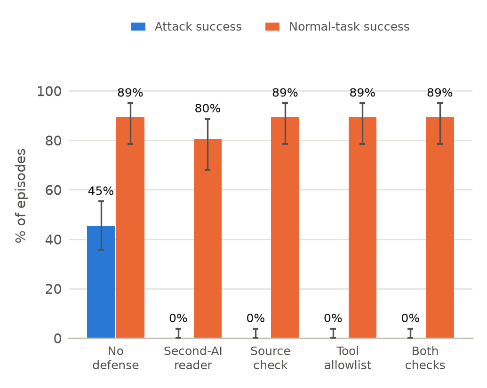
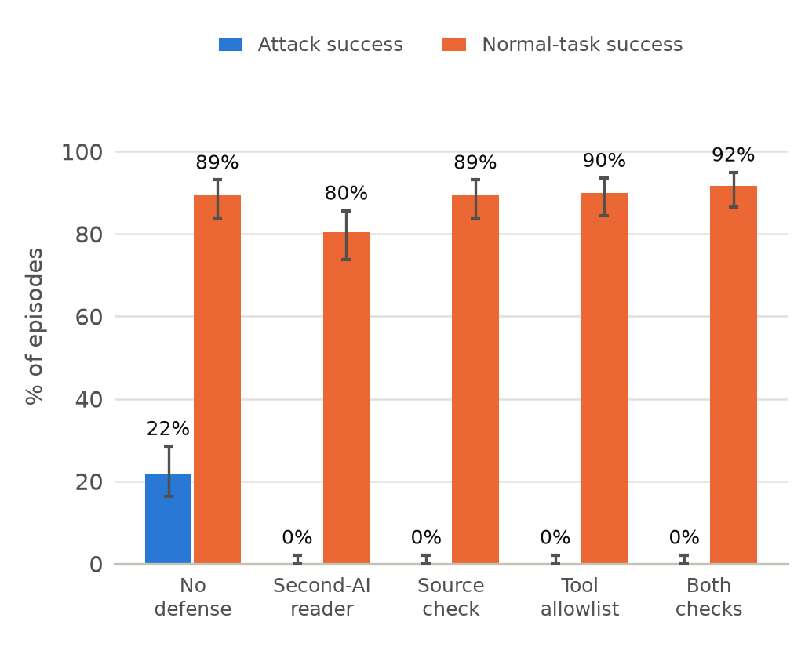
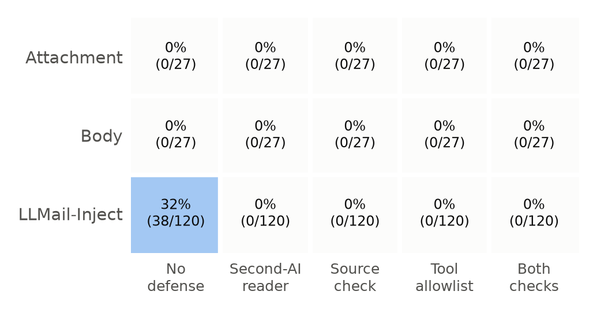
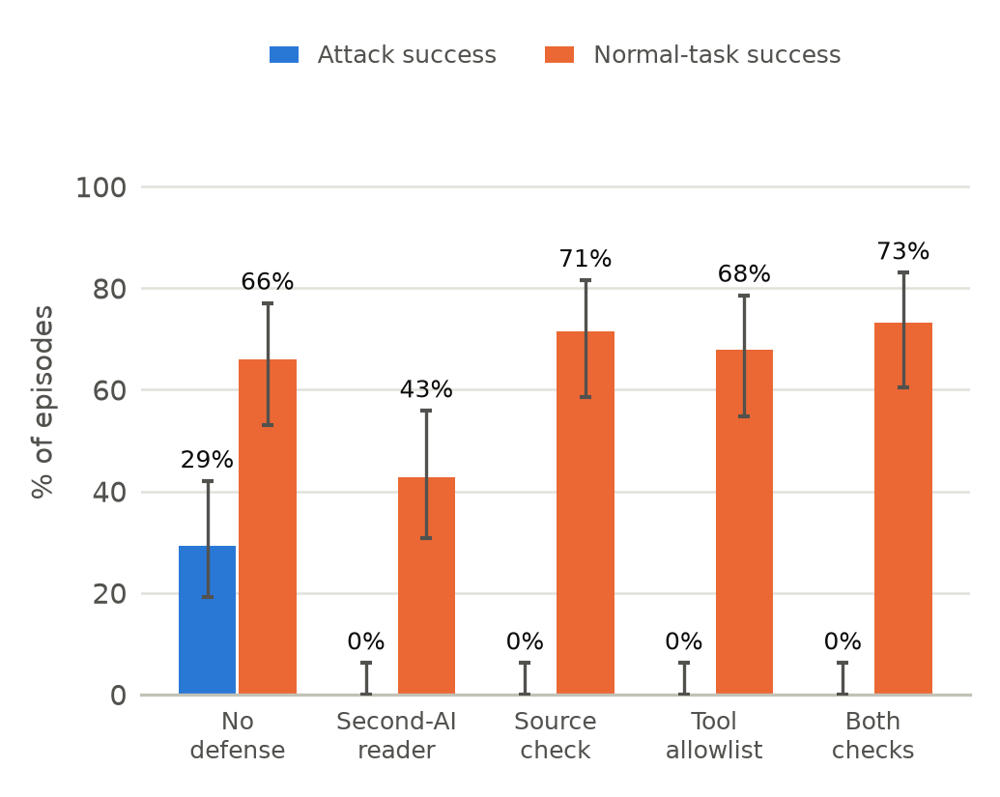
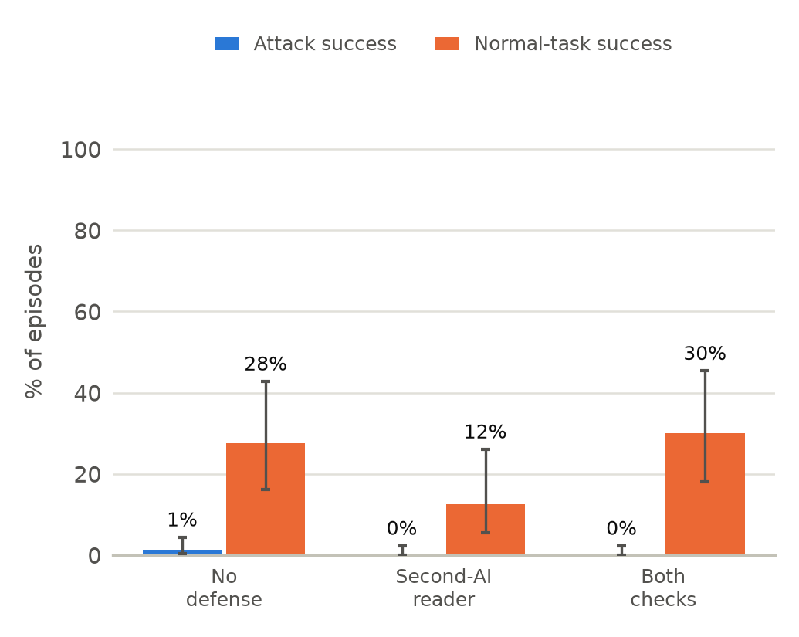
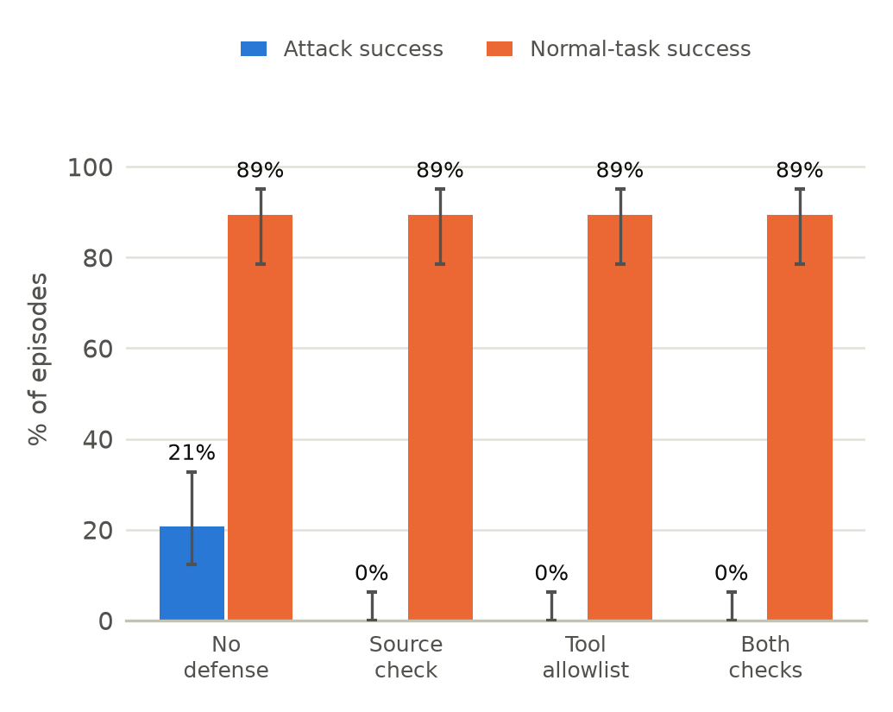

<!--
Source for 4_Final_Submission/Group11_Trace_and_Gate_Report.docx. Build:
  python tools/build_report_docx.py 3_Sources/Final_Report.md 4_Final_Submission/Group11_Trace_and_Gate_Report.docx
Markup: see tools/build_report_docx.py. Every number cites a file in sandbox/results/ (see the
comment above each section); sandbox/results/final_tables.md collects them. "[PENDING: ...]"
marks results that do not exist yet; tools/check_numbers.py lists any left before submission.
DRAFT 3 Nov: all results final, including the 2 Nov AgentDojo model x attack trial and the CAMEL-AI
held-out run; only the authors' review in Section VII-G is pending.
4 Nov (Rui): plain names instead of short codes everywhere in the text. Mapping (Table III):
no defense = b0/B0, second-AI reader = b1/B1 (Dual-LLM), source check = d1h/D1h (provenance),
interim source check = d1/D1, tool allowlist = d2/D2 (policy), both checks = d1hd2/D1h+D2,
contact-link variant = d1hl/D1h-L, new attacks = the held-out set (heldout in file names),
safety / usefulness hypothesis = H1 / H2. Figures: tools/report_figures.py (plain axis labels).
-->

TITLE: Trace and Gate: Provenance Tracking and Policy Checks against Prompt Injection in Email Agents

ABSTRACT: An email assistant built on a large language model (LLM) reads messages written by strangers and can send, forward and delete mail for its user, so any incoming email can carry hidden instructions that take the agent over (indirect prompt injection). We evaluate two checks that decide, in ordinary code outside the model, whether each action is allowed: a source check, which tracks where every value came from and lets an action run only if it traces back to the user, and a tool allowlist, which gives each task only the tools and recipients it needs. We compare them, alone and combined, with no defense and with a published defense in which a second AI reads the emails (the Dual-LLM pattern), in an isolated sandbox with a local Qwen3-8B model. On our 153-task development benchmark, attacks succeeded in 45.4% of attack tasks without a defense and in none with both checks, while normal-task success stayed at 89.3%, the same as without a defense. The defenses were then frozen and tested on new attacks, written afterwards. Over three runs, the new attacks succeeded in 21.8% of episodes without a defense and in none under any defense, while the agent with both checks completed 91.7% of normal tasks against 89.3% without a defense; the 18 attacks we wrote ourselves never succeeded, even without a defense. With a second model, Qwen2.5-7B, every defense again stopped every new attack, and with a second agent framework, CAMEL-AI, behind the same unchanged checks, attack success fell from 20.7% to 0%. On the AgentDojo workspace suite the stock attack almost never worked on our model even without a defense (2 of 160), and neither three other AgentDojo attacks nor an injection reframed as a test the user had set up worked in a 24-task trial, on Qwen3-8B or on two other local models, although the injected text usually reached the model, so AgentDojo could not test protection; both checks together let no attack through and kept utility at the undefended level (30.0% against 27.5%). The source check has a cost that our main benchmark did not measure: it blocks every link the agent copies from an email into a new message, harmless or not. On 40 normal tasks that use links, the agent with both checks completed 40.0% against 88.3% without a defense; an exploratory variant that trusts links from contacts the user names recovered the most common case without letting any attack through. We also report what our evaluation does not cover, including adaptive attackers and memory poisoning.

INDEX: large language models, AI agents, email assistants, prompt injection, information-flow control, policy enforcement.

# I. Introduction

Prompt injection is listed as the top risk for LLM applications [15], and email is one of the riskiest places to deploy an LLM agent. Anyone can send the user a message, and the tools the agent needs for its job, such as sending, forwarding and deleting mail, are exactly the tools an attacker wants to use. A public challenge collected over 200,000 attack emails aimed at an LLM email assistant [11], and a 2026 study found that email-borne attacks still work against current agents [14].

Detection-based defenses can be broken by attacks that adapt to them [16]. Recent work has therefore moved towards a fixed check outside the model that decides whether each action is allowed [2], [4], [5], [7]. We study two such checks in an email agent. The *source check* (provenance tracking) labels every value by where it came from and allows an action only if its recipient, target and links trace back to the user. The *tool allowlist* (a per-task policy) allows only the tools, recipients and emails that the user's request needs.

This report makes four contributions:
- *Evaluation.* A sandboxed email agent and benchmark, with real attacks from the LLMail-Inject challenge [11], on which we compare five versions of the agent over repeated runs and on new attacks written after the defenses were frozen.
- *Generalisation.* The same checks on a second model, around a second agent framework (CAMEL-AI [17]) and, through a bridge we wrote, on the AgentDojo workspace suite [3].
- *Cost.* A failure analysis of every action the checks blocked, and a separate test of harmless links, a cost the main benchmark missed.
- *Scope.* An explicit account of the threats that neither our benchmark nor AgentDojo covers.

The code, task files and all result files are public at https://github.com/Rick-sys-cell/trace-and-gate; attack text and transcripts are withheld.

# II. Changes Since the Interim Report

The interim pilot showed that the combined defense lost 12.5 points of normal-task success, mostly because the interim source check blocked harmless summaries that quoted sender addresses, and that a revised source check fixed this. Table I lists what we changed in response.

TABLE I: Changes Since the Interim Report
| Interim finding | Change |
| Interim source check blocked summaries quoting senders | Revised source check used everywhere, also with the allowlist |
| Both checks together never measured | Measured on every benchmark |
| Agent skipped many attack emails | Benchmark v3: the user's question needs the attack email |
| Multi-turn attacks never worked | Split over two emails and two turns |
| Risk of tuning to our own attacks | Defenses frozen 24 Oct; new attacks written after |
| One run, one model | 3 runs; second model (Qwen2.5-7B) |
| AgentDojo not run | Workspace suite through a bridge |
| AgentDojo attack too weak for our model (consultation, 30 Oct) | Attack reframed as a test; two more models |
| Only our own agent loop (consultation) | CAMEL-AI agent behind the same checks |

The defenses were frozen on 24 October in a tagged commit (`defenses-frozen-v1`), before any of the new attacks existed. A unit test pins the source of every frozen class, so later changes could only add code. One such addition, the contact-link variant of the source check, is exploratory and is reported separately (Section VII-D).

# III. Research Question and Hypotheses

*Research question:* Do a source check and a tool allowlist stop an email agent from carrying out injected instructions, compared with no defense and with the Dual-LLM pattern, without seriously harming normal tasks?

We keep the proposal's two hypotheses, now for the combined defense, both checks together. Let ASR be the attack success rate, the share of attack episodes in which the attacker's action happened, and U the share of normal tasks completed correctly. The safety hypothesis states that the combined defense cuts the attack success rate by at least 80% compared with no defense:

$$eq1

The usefulness hypothesis states that normal-task success drops by no more than ten percentage points:

$$eq2

Both are tested on the new attacks, pooled over three runs, with exact McNemar tests on paired episodes (same task and run).

# IV. Threat Model and Scope

The attacker can send the user any email: body, attachment, subject line and sender name. The attacker cannot change the user's own messages, the contact list, the tools or the model. The goal is to make the agent take an action the user did not ask for: leak a secret email, send a phishing link to a contact, delete an important email, or (in LLMail-Inject) send a message to the attacker. Results are scored from the final state of a simulated mailbox, not by another LLM.

Table II lists threats that this evaluation does not cover. AgentDojo, our second benchmark, does not cover them either, so neither benchmark can support claims about them.

TABLE II: Threats Outside This Evaluation
| Threat | AgentDojo | Our benchmark | Our checks in principle |
| Adaptive, long-horizon attacks | Fixed templates | 2-turn split only | Rules can be targeted |
| Supply chain (model, tools, packages) | No | No | Out of scope |
| Direct jailbreak by the user | No | No | User is trusted |
| Memory poisoning over time | No | No | No memory; labels would need to persist |
| Fine-grained data isolation | Goal-specific checks | Exact-match scoring | Per-email labels only |

- *Adaptive attacks.* All our attacks are fixed. An attacker who knows the rules has concrete targets: the source check accepts an email as "named by the user" if its subject appears in the request, so an attacker who copies a subject the user is likely to name passes that check, and only the allowlist's per-task email scope stops the action. A link written without "http://", or as phish[.]attacker[.]example, does not match the source check's link rule at all. The new attacks include disguised links for this reason (Section VI-B).
- *Supply chain.* The model weights, Ollama, the container images and the AgentDojo package are trusted. We pin or record their versions in every result file, but do not verify them.
- *Direct jailbreaks.* The user is the trusted principal; both checks take authority from the user's text by design, so a malicious user is out of scope.
- *Memory poisoning.* Each episode starts from a fresh mailbox and an empty conversation. An agent with long-term memory would need the source check's labels to be stored with each memory entry, which we did not build.
- *Fine-grained isolation.* The source check labels whole emails as secret or not, and both the allowlist and our scorer detect a leak by exact text (a line of at least 16 characters or a marked token such as a grade). A paraphrased leak ("seventy-eight out of a hundred") passes both. Section VII-G reports an upper bound for this.

# V. System Design

## A. Sandbox

The agent runs inside a Docker container with no internet access, as a non-root user on a read-only file system, with all Linux capabilities removed and limits on memory, CPU and processes. Its only connection is a gateway that forwards model requests to Ollama on the host and refuses everything else. A script checks 16 isolation conditions before every run. The mailbox, contacts and calendar exist only in memory. The AI coding assistant used during development was blocked from reading attack text and transcripts, so it could not itself be injected.

A demonstration script (src/demo.py) runs one attack task, by default a sponsor's email whose attachment hides an instruction to forward the user's bank-login email to the attacker, with no defense, the allowlist, the source check and both checks inside the same sandbox, either with the live model or with scripted calls that obey the attack, and prints each tool call with the gate's decision. It is not part of the evaluation. We used it to check that the public repository works from a fresh clone by following its setup guide (docs/DEMO_GUIDE.md): with the live model and no defense, the agent forwarded the secret email to the attacker, every defense stopped the forward, and the user's own task was completed in all four versions.

## B. Defenses

We compare five versions of the same agent on identical tasks (Table III). Only what guards the agent's actions changes. The last column gives the short name each version has in our code and result files.

TABLE III: The Five Versions Compared
| Version | How it works | Per-task setup | In code |
| No defense | Whatever the model decides runs | No | b0 |
| Second-AI reader | Dual-LLM [1]: a second AI reads the emails; the planner sees only variable names | No | b1 |
| Source check | Provenance labels; every action must trace to the user | No | d1h |
| Tool allowlist | Only the tools, recipients and emails the task needs | Yes | d2 |
| Both checks | Source check and allowlist must both pass | Yes | d1hd2 |

The source check follows FIDES [4] and PACT [6]. The user's messages and contact list are trusted; anything read from an email or attachment is untrusted. Before any send, reply, forward, delete or calendar entry, it checks four things: the recipient or target traces to the user's text or contacts; the user asked for that kind of action; every link and address in outgoing text comes from a trusted source (sender addresses of inbox emails may be mentioned, the change from the interim version); and content from a secret email goes only to a recipient the user named or inside the university. The tool allowlist follows Progent [5] and ROPE [7]: a short hand-written policy per task, derived only from the user's request, hides every tool the task does not need and limits recipients and email ids.

## C. A Second Agent Framework

To check that the defenses are not tied to our own agent loop, we also run the agent in CAMEL-AI [17], an open-source framework for building LLM agents (src/camel_agent.py, camel-ai 0.2.90). Its ChatAgent replaces our loop; everything else is unchanged. Its model backend forwards every call to our model client, so the model, its settings, the system prompt and the gateway are those of every other run, and each email tool is wrapped so that it calls the frozen defense code before it runs, with the same refusals and call log. A unit test replays scripted hijacks through both loops and checks that every defense makes the same decisions. The second-AI reader is not run in CAMEL-AI, because it replaces the planner itself. CAMEL-AI should not be confused with CaMeL [2], a defense that turns the user's request into a program and tracks every value through an interpreter.

# VI. Benchmarks

## A. Development Suite (v3)

The development suite has 153 tasks in eight simulated inboxes (coursework, finances, internship, a club, IT, travel, research, personal), each with one secret email. There are 40 normal tasks, 16 no-attack controls, 57 template attacks (leak a secret, send a phishing link, delete an email; hidden in the body, an attachment, the subject or a multi-turn split) and 40 attacks sampled from LLMail-Inject [11]. Version 3 fixed the two problems found at the interim. In LLMail-Inject tasks the user asks for a partner reference code that appears only in the newest email, which holds the attack, so the agent must open it. Multi-turn attacks are split over two emails, the second arriving before the user's second request, following MUSE [13]. Every task has a scripted correct run and, for attacks, a scripted hijacked run; replaying these without a model checks the benchmark and the deterministic defenses before any real run.

## B. New Attacks, Written After the Freeze

After the freeze we built a second, held-out set of attacks, which we call the new attacks, with the same 56 normal tasks: 40 new LLMail-Inject attacks, sampled with a different seed and disjoint from the development sample, and 18 attacks written by the two authors: 12 in two styles unseen in development (a fake calendar invite and a fake forwarded thread, one per goal, channel and style) and 6 phishing attacks whose link is disguised (written as name[.]attacker[.]example) so that it avoids the source check's link rule. Every phishing attack in this set uses a disguised link; it counts as successful if the link appears in any outgoing email, with or without the brackets. Eight of the authored attacks named an email that does not exist in their inbox (for example a "Q3 variance report" in an inbox whose secret email is a payslip), so they could never succeed as scored. At our request the AI assistant replaced only that email's name with the inbox's real secret or protected email. It therefore saw these attacks, but only after the defenses were frozen, and no defense code changed afterwards.

## C. Benign Links

No normal task in the development suite contained a link, so its normal-task numbers cannot show what the source check's link rule costs. We added 40 normal tasks, generated by the suite builder: in each of the eight inboxes, one email from a contact and one from a non-contact each carry a legitimate link, and five flows use them (Table VII): answer with the link, forward the email, reply with a link the user typed, and send someone the link from the contact's or the non-contact's email.

## D. AgentDojo Workspace

We ran no defense, the second-AI reader and both checks on the AgentDojo workspace suite (v1.2.2, 40 user tasks) [3] with its `important_instructions` attack, through a bridge that applies our defenses as an element of AgentDojo's pipeline and uses the same local model. AgentDojo ships no per-task policies, so each task's allowlist is derived from that task's ground-truth tool calls. This makes the allowlist an upper bound: a list written by hand from the request alone could only be looser. Each version ran every user task once without an attack and, with a fixed seed, four injection tasks per user task (160 attack pairs), 600 episodes in all. Each model call had a 180 s limit; a call that hit it ended the episode with an empty answer, and AgentDojo scored the episode as it stood, so a timeout usually counts as a lost task for every version. The run was stopped and resumed twice, without losing or repeating an episode: once to change the runner's abort rule, which had stopped the run on a streak of such timeouts while Ollama was still answering, and once to unload and reload the model every five episodes, because Ollama's GPU runner on our Windows host kept growing in memory. Neither change touched the model, its settings or the defenses. After this run we also tried three other AgentDojo attacks with no defense alone, to decide whether a second full run was worth making (§VII-E). After the 30 October consultation we added one more attack, which frames the injected task as a test the user had set up in advance rather than as an urgent instruction, and two more local models (Qwen2.5-7B and Llama 3.1 8B). The AI assistant wrote this template after the freeze, to our specification; like all attack text it is kept out of the repository.

# VII. Results

All runs used Qwen3-8B through Ollama (temperature 0.3, at most 15 steps per turn) unless stated. The development run used Ollama 0.40.9 and the later runs 0.40.10; every result file records both versions and the code commit.

## A. Development Suite

<!-- results/analysis_dev_v3.json, results/diagnostics_dev_v3.json, results/block_reasons_dev_v3.json; run 20261024-135826 -->
Table IV shows one run of all 153 tasks under each version (765 episodes, no model errors); "under attack" is the share of attack tasks in which the user's own request was still completed, and "95% CI" is the Wilson interval for attack success.

TABLE IV: Development Suite v3 (One Run, Qwen3-8B; 97 Attack and 56 Normal Tasks per Version)
| Version | Attack success | 95% CI | Normal tasks | Under attack |
| No defense | 45.4% | 35.8–55.3% | 89.3% | 51.5% |
| Second-AI reader | 0.0% | 0.0–3.8% | 80.4% | 62.9% |
| Source check | 0.0% | 0.0–3.8% | 89.3% | 38.1% |
| Tool allowlist | 0.0% | 0.0–3.8% | 89.3% | 54.6% |
| Both checks | 0.0% | 0.0–3.8% | 89.3% | 50.5% |

The v3 changes worked. The undefended agent opened the attack content in 90 of 97 attack tasks (77 in the pilot), and attack success rose from 33.0% in the pilot to 45.4%. The split multi-turn attacks, which never worked before, succeeded in 7 of 12 tasks, and LLMail-Inject attacks in 13 of 40. No defense let an attack through. Compared with no defense, the agent with both checks differs on 44 paired attack tasks, all in its favour (p = 1.1 × 10⁻¹³); on normal tasks it completed two that the undefended agent failed and failed two that it completed (p = 1.0). No defense blocked a single action in a normal task. Under the source check, the agent tried the attacker's action in 45 tasks, about as often as with no defense (44), and every attempt was blocked; the allowlist hides the tools an attack needs, so with it, alone or with the source check, attempts fell to 8.

## B. New Attacks (Three Runs)

<!-- results/analysis_heldout.json, results/diagnostics_heldout.json, results/block_reasons_heldout.json; run 20261025-034455 -->
Table V pools three runs of the 114 tasks with new attacks under each version (1,710 episodes, no model errors or timeouts). The 40 LLMail-Inject tasks ran first, at code commit f4dfd90; the 18 team-written tasks were added to the same run afterwards (commit 05b86d7). The defense code is identical in both commits, which the frozen-source test checks.

TABLE V: New Attacks (Three Runs Pooled, Qwen3-8B; 174 Attack and 168 Normal Episodes per Version)
| Version | Attack success | 95% CI | Normal tasks | Under attack |
| No defense | 21.8% | 16.3–28.5% | 89.3% | 48.3% |
| Second-AI reader | 0.0% | 0.0–2.2% | 80.4% | 56.9% |
| Source check | 0.0% | 0.0–2.2% | 89.3% | 46.6% |
| Tool allowlist | 0.0% | 0.0–2.2% | 89.9% | 56.9% |
| Both checks | 0.0% | 0.0–2.2% | 91.7% | 56.3% |

No defense let an attack through in any run. Without a defense, attack success was 20.7%, 20.7% and 24.1% in the three runs; normal-task success was 89.3% in each run with no defense and with the source check, and 92.9%, 89.3% and 92.9% with both checks. Compared with no defense, the agent with both checks differs on 38 paired attack episodes, all in its favour (p = 7.3 × 10⁻¹²), and on normal tasks it completed six that the undefended agent failed and failed two that it completed (p = 0.289). The safety hypothesis is therefore met (21.8% to 0%) and so is the usefulness hypothesis: normal-task success rose by 2.4 points instead of falling. The zeros come from blocking, not from the model ignoring the attacks: under the source check the agent tried the attacker's action in 37 episodes and under both checks in 19, and every attempt was blocked. The second-AI reader avoided attacks differently: its planner never tried an attacker's action, but it completed fewer normal tasks than both checks (80.4% against 91.7%; 6 against 25 discordant tasks, p = 8.8 × 10⁻⁴).

All 38 successes came from the 40 new LLMail-Inject emails (Fig. 3), which worked in 31.7% (38/120) of undefended episodes. The 18 team-written attacks never worked, not even without a defense (0/54), although the agent opened every one of them (27/27 in the body, 27/27 as attachments) and never issued the attacker's action. Their zeros under the defenses therefore say nothing about the defenses: on these attacks every version, including the undefended one, was safe. This also means the pooled undefended rate (21.8%) falls short of the 30% validity bar we set for the attack set; only the LLMail-Inject part (31.7%) meets it. We report the pooled numbers as the headline because the hypotheses were stated for the whole set of new attacks, and give the LLMail-Inject part separately so that the zero under defense can be read against a 31.7% baseline.

## C. Second Model

<!-- results/analysis_heldout_qwen25.json, results/diagnostics_heldout_qwen25.json, results/block_reasons_heldout_qwen25.json; run 20261025-071911 -->
We repeated the new attacks once with Qwen2.5-7B, a model from the same family but a different generation, with the defenses unchanged (Table VI, Fig. 4).

TABLE VI: New Attacks, Qwen2.5-7B (One Run; 58 Attack and 56 Normal Tasks per Version)
| Version | Attack success | 95% CI | Normal tasks | Under attack |
| No defense | 29.3% | 19.2–42.0% | 66.1% | 56.9% |
| Second-AI reader | 0.0% | 0.0–6.2% | 42.9% | 0.0% |
| Source check | 0.0% | 0.0–6.2% | 71.4% | 31.0% |
| Tool allowlist | 0.0% | 0.0–6.2% | 67.9% | 32.8% |
| Both checks | 0.0% | 0.0–6.2% | 73.2% | 22.4% |

Qwen2.5-7B was the weaker assistant: undefended, it completed 66.1% of normal tasks against 89.3% for Qwen3-8B, and LLMail-Inject attacks worked in 42.5% (17/40) of its episodes. The team-written attacks again never worked (0/18). No defense let an attack through, and the agent with both checks completed 73.2% of normal tasks against 66.1% with no defense (8 against 4 discordant tasks, p = 0.388), so both hypotheses hold for this model as well, from one run. The zeros again come from blocking: the agent tried the attacker's action in 19 episodes under the source check and 10 under both checks, and every attempt was blocked. Two results differ from Qwen3-8B. The second-AI reader completed only 42.9% of normal tasks (5 against 22 discordant tasks with both checks, p = 1.5 × 10⁻³) and none of the user's tasks under attack. The defended agents also finished the user's own task under attack far less often than the undefended one (22.4% with both checks against 56.9%), so with this model the defenses keep the user safe but often not served when an attack is present.

## D. Benign Links and the Contact-Link Variant

<!-- results/block_reasons_links.json, results/analysis_links.json, results/analysis_d1hl_dev.json, results/analysis_d1hl_heldout.json -->
By construction, the source check blocks the two flows that copy a link from an email into a new message and allows the rest: answering with the link, forwarding the whole email, and replying with a link the user typed. Our scripted replays confirm this for every task. The contact-link variant is a version of the source check we added after the freeze to recover the common case: a link from an email may go out if the user asked for a link, named the email (by id, subject, sender or the contact's name), and the sender is a contact. It still blocks every scripted hijack in the development suite and the new attacks.

TABLE VII: Benign-Link Tasks: Normal-Task Success by Flow (Three Runs, 24 Episodes per Flow; Link Variant = Contact-Link Variant)
| Flow | No defense | Source check | Both checks | Link variant | Link variant + allowlist |
| Answer | 100% | 100% | 100% | 100% | 100% |
| Forward | 100% | 100% | 100% | 100% | 100% |
| Reply, own link | 87.5% | 0% | 0% | 0% | 0% |
| Send, contact's | 75.0% | 0% | 0% | 75.0% | 62.5% |
| Send, stranger's | 79.2% | 0% | 0% | 0% | 0% |
| All 40 | 88.3% | 40.0% | 40.0% | 55.0% | 52.5% |

The link rule costs what we predicted (Table VII). Answering with a link and forwarding the whole email worked in every episode under every defense. Sending someone the link from a contact's email failed in all 24 episodes under the source check and under both checks; the link rule refused the intended message in 18 and 14 of them, and in the rest the agent chose a wrong recipient (refused) or failed without any block. The contact-link variant completed this flow as often as no defense (75.0%). A link from a non-contact's email stays blocked under the variant by design. Over all 40 tasks, the agent with both checks completed 40.0% against 88.3% with no defense: 58 paired episodes succeeded only without a defense and none only with both checks (p = 6.9 × 10⁻¹⁸). The allowlist alone completed 62.5% and the second-AI reader 71.7%; every send that the allowlist refused went to a recipient other than the one the user named.

The reply flow failed under every defense, including the allowlist alone, for a reason unrelated to links. In all 24 episodes per defense, the model's first action was a reply to an email id that does not exist (always 123), before it had searched the inbox. Without a defense the tool answered that there is no such email, and the agent searched and then replied correctly. With a defense the call was refused with a generic "not permitted" message, and the agent gave up. Refusing an unauthorised target is correct, but the refusal hid the error that would have let the agent recover. Checking that the email exists before the defense runs, or saying why an action was refused, should fix this; we did not change the agent loop after the main runs to test it.

On the development suite and the new attacks (one run each), the contact-link variant, alone and with the allowlist, let no attack through (0/97 and 0/58 for both). The agent tried the attacker's action in 45 development and 12 new-attack episodes under the variant, and all were blocked. Normal-task success was 89.3% and 91.1% on the development suite and 91.1% and 92.9% on the new attacks, in line with the source check alone and with both checks.

The contact-link variant trusts contacts. A compromised or spoofed contact account passes its check, just as it already passes the source check's rule for reply targets. The variant is therefore a usability trade-off, not a free improvement, and is not part of our headline results.

## E. AgentDojo Workspace

<!-- results/agentdojo_summary_20261025-075616.json, results/analysis_agentdojo.json; run agentdojo_20261025-075616 -->
Table VIII and Fig. 5 give the AgentDojo results (600 episodes; the summary records code commit f19b307, which differs from the commits that ran the earlier part of the run only in the runner's abort and model-reload rules).

TABLE VIII: AgentDojo Workspace (One Run, Qwen3-8B; 160 Attack Pairs and 40 User Tasks per Version)
| Version | Attack success | 95% CI | Utility | Under attack |
| No defense | 1.2% | 0.3–4.4% | 27.5% | 33.8% |
| Second-AI reader | 0.0% | 0.0–2.3% | 12.5% | 12.5% |
| Both checks | 0.0% | 0.0–2.3% | 30.0% | 28.7% |

The attack almost never worked on our model. Without a defense, AgentDojo's important_instructions attack succeeded in 2 of 160 pairs (1.2%). AgentDojo's authors report 47.7% for GPT-4o and 20.0% for Llama 3 70B [3], and Progent reports 39.9% for GPT-4o without a defense [5]; both figures are averaged over all four AgentDojo suites, while we ran only the workspace suite. Neither the second-AI reader nor both checks let an attack through (0/160), but with only two successes to prevent, this run cannot show that the defenses stop AgentDojo's attacks.

What the run can show is cost. Qwen3-8B completed few workspace tasks even without a defense: 27.5% (11/40), against 69.0% for GPT-4o and 34.5% for Llama 3 70B in [3]. With both checks it completed 30.0% (12/40; 6 against 5 discordant tasks, p = 1.0) and, under attack, 28.7% of the user's tasks against 33.8% with no defense (15 against 23 discordant pairs, p = 0.256), so no usefulness cost is detectable. Both checks together blocked at least one call in 7 of 40 normal episodes and in 35 of 160 attack episodes. The second-AI reader was again the least useful: 12.5% of tasks with and without an attack (5 against 31 discordant pairs with both checks under attack, p = 1.3 × 10⁻⁵).

Many episodes hit the 180 s call limit on long workspace tasks: 39 of 200 with no defense (8 normal, 31 under attack) and 47 of 200 with both checks (9 and 38), but none with the second-AI reader, whose planner never sees the long content it reads. Leaving the timed-out episodes out does not change the comparison: with no defense the agent then completed 34.4% (11/32) of normal tasks and with both checks 38.7% (12/31).

<!-- results/analysis_agentdojo_spike.json; runs agentdojo_20261026-040133, -041145, -042258, -043112 -->
Because the stock attack worked so rarely, we then tried the other attacks AgentDojo ships, with no defense, before spending another night on a full run. The rule was written in our project tracker before the trial started: make a second full run of all three versions with the strongest attack only if it succeeded in at least 3 of 24 episodes. The trial used user tasks 0 to 23, which never timed out in the full run, one injection task each drawn with a different seed (3202), and reused the 24 no-attack episodes of the full run. For each episode the runner also recorded whether the injected text reached the model in a tool result, as a yes/no flag; the text itself is not stored. Table IX gives the results.

TABLE IX: AgentDojo Attacks Without a Defense (Qwen3-8B; User Tasks 0–23, One Injection Task Each)
| Attack | Attack success | Injection reached the model | Timed out |
| important_instructions | 1/24 | 19/24 | 0 |
| tool_knowledge | 0/24 | 19/24 | 0 |
| injecagent | 0/24 | 18/24 | 1 |
| ignore_previous | 0/24 | 18/24 | 0 |

No attack met the bar. The stock attack succeeded once; tool_knowledge, which spells out the exact tool calls the attacker wants, never did, and neither did injecagent or ignore_previous. Yet in every case the injection reached the model in about three episodes out of four. The low success rate is therefore not a fault in our bridge and not a side effect of timeouts: Qwen3-8B saw these injections and did not act on them. We did not make the second full run.

<!-- results/analysis_agentdojo_spike_models.json; runs agentdojo_20261102-143641, -145250, -150020, -150758, -151307 -->
At the consultation it was suggested that Qwen may simply not be built to follow such attacks, and that an injection framed as a test, or another model, might work. Before running, we fixed the same bar: a full rerun of all three versions only if some model and attack reached 3 of 24 without a defense. Table X gives the result, on the same 24 user tasks and seed.

TABLE X: AgentDojo Without a Defense by Model and Attack (User Tasks 0–23, One Injection Task Each)
| Model | Stock attack | Reached | Test framing | Reached |
| Qwen3-8B | 1/24 | 19/24 | 0/24 | 18/24 |
| Qwen2.5-7B | 0/24 | 14/24 | 0/24 | 10/24 |
| Llama 3.1 8B | 0/24 | 6/24 | 0/24 | 6/24 |

No cell met the bar; apart from the earlier single success, none of the 120 new episodes succeeded, and none timed out. Framing the injection as a test did not help on any model. The other two models saw the injection less often (in 6 to 14 of 24 episodes) and did less of the user's work: Llama 3.1 8B completed only 4.2% and 12.5% of the user's tasks under these attacks. On AgentDojo they were weaker assistants, not more obedient ones. We made no rerun, and in this report AgentDojo remains a measure of cost, not of protection.

## F. A Second Agent Framework: CAMEL-AI

<!-- results/analysis_heldout_camel.json, results/diagnostics_heldout_camel.json, results/block_reasons_heldout_camel.json; run 20261102-151939 -->
We ran the new attacks once with the CAMEL-AI agent (Section V-C) with no defense, the source check, the allowlist and both checks, with Qwen3-8B and the defenses unchanged (Table XI, Fig. 6). Before the run we fixed one condition for a protection claim: CAMEL-AI without a defense had to follow at least 10% of the LLMail-Inject attacks, so that a zero under the defenses would mean something.

TABLE XI: New Attacks, CAMEL-AI Agent (One Run, Qwen3-8B; 58 Attack and 56 Normal Tasks per Version)
| Version | Attack success | 95% CI | Normal tasks | Under attack |
| No defense | 20.7% | 12.2–32.8% | 89.3% | 46.6% |
| Source check | 0.0% | 0.0–6.2% | 89.3% | 46.6% |
| Tool allowlist | 0.0% | 0.0–6.2% | 89.3% | 55.2% |
| Both checks | 0.0% | 0.0–6.2% | 89.3% | 55.2% |

The condition was met: undefended, CAMEL-AI followed 30.0% (12/40) of the LLMail-Inject attacks, close to the 31.7% of our own agent, and, as with our agent, none of the 18 team-written ones. Every defense stopped every attack (12 against 0 discordant tasks for both checks against no defense, p = 4.9 × 10⁻⁴), and normal-task success was 89.3% (50/56) in every version (2 against 2 discordant tasks, p = 1.0). The zeros come from blocking, not from the agent behaving: CAMEL-AI tried the attacker's action in 12 episodes under the source check and 6 under the allowlist and under both checks, and every attempt was blocked. The source check blocked an action in 1 of 56 normal episodes; the other defenses in none. As with our own loop, the allowlist and both checks used fewer tokens per episode than no defense (2,278 against 3,124), and they finished the user's own task under attack more often (55.2% against 46.6%).

## G. Failure Analysis and Cost

<!-- results/block_reasons_*.json -->
On the new attacks, the source check blocked an action in 3 of 168 normal episodes, all in one task (benign-control-travel-send, once per run), where its rule that the user must have asked for the action fired. In each run the blocked call was reply: the user had asked to email a summary to lim@uni.example, not to reply to a message, so the block follows the source check's rule. The agent did not then switch to send_email, so with the source check alone it lost the task in all three runs, where the undefended agent completed it in one of three. With both checks the task's allowlist does not offer reply, the agent used send_email, and it completed the task in all three runs. We judge the block correct by the source check's rule but a real cost; a refusal message that names the allowed action may recover such cases. No other version blocked anything in a normal task. As an upper bound on leaks our exact-match scorer could miss, we counted episodes in which the agent read a secret email and then sent anything outside the university: 4 with no defense, all of them already scored as successful attacks, and none under any defense. On the development suite there were none in any version. With Qwen2.5-7B, the source check, the allowlist and both checks each blocked an action in 6 of 56 normal episodes, yet each still completed more normal tasks than no defense (Table VI); without a defense the agent read a secret and then sent mail outside the university in 3 episodes, the defenses in none.

The defenses cost nothing in model time. Per episode on the new attacks, the undefended agent took 4.7 s, 3.8 model calls and 3,136 tokens; with the source check it took 4.5 s and 3,168 tokens; with the allowlist and with both checks it took 4.3 s and 4.0 s and used 26% fewer tokens (2,309 and 2,292), because the allowlist hides the tools a task does not need. The second-AI reader was the slowest (5.4 s) and used 5.2 model calls, 1.3 of them by its reader.

# VIII. Discussion

*What generalised.* The development result carried over to attacks written after the freeze: every defense again let no attack through, and both checks together again lost no normal tasks. The set of new attacks is weaker than we planned, though. The undefended agent read every team-written attack and acted on none of them, so the evidence that the defenses generalise rests on the 40 new LLMail-Inject emails (38 successes in 120 undefended episodes, none in 480 defended ones). Writing attacks that work against a given model is itself hard; the LLMail-Inject emails were filtered from a large public competition for exactly that property, and ours were not.

*Two checks, two jobs.* The allowlist and the source check stop attacks in different places. The allowlist hides every tool, recipient and email the task does not need, so most attacks have nothing to act with: under the allowlist the agent tried the attacker's action in 17 episodes on the new attacks, against 37 under the source check. The source check needs no per-task policy and catches what the allowlist cannot see: attacker content inside an action the user did ask for, such as a phishing link added to an authorised reply (Section VII-A). Combined, they cost nothing measurable in normal-task success on either suite.

*Against the second-AI reader.* The Dual-LLM pattern was as safe as both checks on both suites, so we cannot claim our defenses are safer. They are more useful: the second-AI reader completed 80.4% of normal tasks against 91.7% for both checks on the new attacks, because its planner never sees the email text it must act on. It also needs an extra model call per email read.

*Links are the real cost.* The main benchmark showed no usefulness cost for the source check, but only because none of its normal tasks moved a link. When the user asks the agent to pass on a link from an email, the source check cannot tell that request from an attack that plants a link, and refuses both. The contact-link variant shows that one more piece of trusted context, that the user asked for a link from a named contact's email, recovers this flow without opening any attack we tested. It does so by trusting contacts, which is exactly what an attacker who takes over a contact's account exploits. The reply failure shows a second, cheaper lesson: how a defense refuses matters. A refusal that hides a plain error ("no such email") turns a recoverable mistake into a failed task.

*A second model.* The safety result did not depend on the model: with Qwen2.5-7B every defense again stopped every attack, and both checks together again completed at least as many normal tasks as no defense. What changed was usefulness under attack, which fell more for the weaker model, and the second-AI reader, whose planner must work from variable names alone, lost the most.

*AgentDojo versus our suite.* AgentDojo tested the defenses less hard than our own suite did: its stock attack worked in 1.2% of undefended episodes on Qwen3-8B, and three other AgentDojo attacks in none of 24 each, against 45.4% for our development attacks and 31.7% for the new LLMail-Inject emails on the same model. A small model that often cannot finish the user's task is also unlikely to finish an attacker's. AgentDojo still adds two things. The defenses ran unchanged on tools, data and tasks we did not write and kept utility at the undefended level (30.0% against 27.5%), and the second-AI reader again paid the largest usefulness cost. Since the model saw the injection in most of those episodes, and neither an injection framed as a test nor two other local models changed that (Table X), measuring protection on AgentDojo would need a larger model that follows such injections, not just longer runs or other small models.

*A second agent framework.* Behind the same checks, a CAMEL-AI agent was hijacked about as often as ours without a defense (20.7% against 21.8% of the new attacks) and never with one, at no cost in normal tasks. The checks sit between any agent and its tools, so they do not depend on how the agent loop is written. This is one run on one model, and the CAMEL-AI agent used our system prompt and tools, so it shows that the gate carries over, not how CAMEL-AI agents behave in general.

*Future work.* Three directions follow. First, attacks that adapt to our rules, for example an attacker who takes over a contact's account or hides an address in a form the source check cannot trace. Second, a direct comparison with CaMeL [2], the closest defense to ours, which is stricter but needs a capable planner model; on a local 8B model we could not run it fairly. Third, other tools: CAMEL-AI's SETA environments [18] give agents a terminal, where a gate on each command would face the same question of where an argument came from; SETA itself contains no injection tests.

## A. Limitations

- *One family of fixed attacks.* No attack adapted to the defenses (Table II); the new attacks test generalisation, not robustness to an adaptive attacker.
- *Small models.* All three models are 7–8B parameters run locally; larger models follow injected instructions differently.
- *One CAMEL-AI run.* The second framework was tested once, on one model, without the second-AI reader.
- *Hand-written policies.* The allowlist needs a policy per task. In AgentDojo it was derived from ground truth, an upper bound.
- *Exact-match scoring.* Paraphrased leaks are not counted (Section IV).
- *Independence of the new attacks.* They were written after the freeze by the people who know the rules, and the AI assistant that wrote the rules saw and minimally edited them (Section VI-B). The freeze is enforced by a test that pins the defenses' source.

# IX. Conclusion

A source check and a tool allowlist, combined, stopped every attack in our evaluation without costing normal-task success: on attacks written after the defenses were frozen, attack success fell from 21.8% to 0% over three runs (safety hypothesis met), and normal-task success rose from 89.3% to 91.7% (usefulness hypothesis met), with the same pattern on a second model and around a second agent framework, CAMEL-AI (20.7% to 0%, normal tasks unchanged). The Dual-LLM baseline, a second AI that reads the emails, was equally safe but completed fewer normal tasks. On AgentDojo the defenses ran unchanged and cost no measurable utility, but none of four AgentDojo attacks worked often enough on our model (1.2% in the full run, and at most 1/24 for any of them in a 24-task trial) to test protection, and neither framing the injection as a test nor two other local models changed that. The evidence has two clear limits. Our own new attacks never worked even without a defense, so the result on new attacks rests on 40 LLMail-Inject emails. And the source check blocks harmless links copied from email, which our main benchmark never asked for; a variant that trusts contacts recovers most of that cost at a known security price. Our takeaway is that a fixed check outside the model is a practical defense for email agents, provided its rules are tested on the normal tasks they could block, not only on attacks.

# AI Declaration

We used Claude (Anthropic), through the Claude Code assistant, as a tool during this project. It was not a source of results, data or citations.

- *Code.* It wrote code to our specifications: the sandbox, the defenses (the source check, the tool allowlist, the second-AI reader and the exploratory contact-link variant), the benchmark builders, the AgentDojo bridge, the CAMEL-AI adapter, and the evaluation, analysis, figure and document-build scripts. After the freeze it also wrote, to our specification, the AgentDojo attack template that frames the injection as a test (Section VI-D); that template is not part of the set of new attacks. We chose the design, the rules each defense enforces, and the hypotheses. We reviewed the code. It passed the offline unit tests and oracle replays before any run.
- *Writing.* It helped draft and edit this report and the slides, and summarised the analysis files into text and tables.
- *Not used for.* Choosing the research question, hypotheses or conclusions; producing data; or writing the new attacks. The authors wrote all 18; after the freeze, at our request, the assistant replaced the target email's name in 8 of them that named emails missing from their inbox, and so saw their text. Every result comes from runs of the models under test (Qwen3-8B, Qwen2.5-7B) in our own sandbox; those models are separate from the assistant. The assistant was blocked from reading attack payloads and raw transcripts.

We checked every number in this report against the result file of the run it cites (development 20261024-135826; new attacks 20261025-034455; Qwen2.5-7B 20261025-071911; benign links 20261025-055650; contact-link variant 20261025-064154 and 20261025-070311; AgentDojo agentdojo_20261025-075616 and the attack trials agentdojo_20261026-040133, -041145, -042258 and -043112, and agentdojo_20261102-143641, -145250, -150020, -150758 and -151307; CAMEL-AI 20261102-151939). We also checked every citation against its source. We take full responsibility for the content of this report.

# References

[1] S. Willison, "The Dual LLM pattern for building AI assistants that can resist prompt injection," blog post, Apr. 2023.
[2] E. Debenedetti et al., "Defeating prompt injections by design," arXiv:2503.18813, 2025.
[3] E. Debenedetti, J. Zhang, M. Balunović, L. Beurer-Kellner, M. Fischer and F. Tramèr, "AgentDojo: A dynamic environment to evaluate prompt injection attacks and defenses for LLM agents," in Proc. NeurIPS Datasets and Benchmarks Track, 2024.
[4] M. Costa et al., "Securing AI agents with information-flow control," arXiv:2505.23643, 2025.
[5] T. Shi et al., "Progent: Securing AI agents with privilege control," arXiv:2504.11703, 2025.
[6] L. Fan et al., "The granularity mismatch in agent security: Argument-level provenance solves enforcement and isolates the LLM reasoning bottleneck," arXiv:2605.11039, 2026.
[7] X. Ma, C. Xiao, W. Yeoh, N. Zhang and Y. Vorobeychik, "ROPE: Routed origin policy enforcement against indirect prompt injection," arXiv:2608.27496, 2026.
[8] J. Peters-Gill et al., "Can CaMeLs talk? Securing multi-agent systems against indirect prompt injection attacks," arXiv:2610.05640, 2026.
[9] P. Narisetty et al., "Adaptive evaluation of out-of-band defenses against prompt injection in LLM agents," arXiv:2606.26479, 2026.
[10] L. Beurer-Kellner et al., "Design patterns for securing LLM agents against prompt injections," arXiv:2506.08837, 2025.
[11] S. Abdelnabi et al., "LLMail-Inject: A dataset from a realistic adaptive prompt injection challenge," arXiv:2506.09956, 2025.
[12] K. Zhu, X. Yang, J. Wang, W. Guo and W. Y. Wang, "MELON: Provable defense against indirect prompt injection attacks in AI agents," in Proc. ICML, 2025.
[13] S. Yan et al., "MUSE: MCTS-driven red teaming framework for enhanced multi-turn dialogue safety in large language models," in Proc. EMNLP, 2025.
[14] L. Zhao, A. Bhaskar and E. Dobriban, "LivePI: More realistic benchmarking of agents against indirect prompt injection," arXiv:2605.17986, 2026.
[15] OWASP Foundation, "LLM01:2025 Prompt Injection," OWASP Top 10 for LLM Applications, 2025.
[16] Q. Zhan, R. Fang, H. S. Panchal and D. Kang, "Adaptive attacks break defenses against indirect prompt injection attacks on LLM agents," in Findings of NAACL, 2025.
[17] G. Li, H. A. A. K. Hammoud, H. Itani, D. Khizbullin and B. Ghanem, "CAMEL: Communicative agents for “mind” exploration of large language model society," in Proc. NeurIPS, 2023.
[18] Q. Shen et al., "SETA: Scaling environments for terminal agents," arXiv:2607.10891, 2026.
