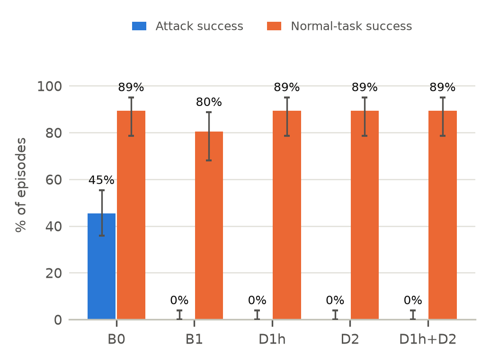
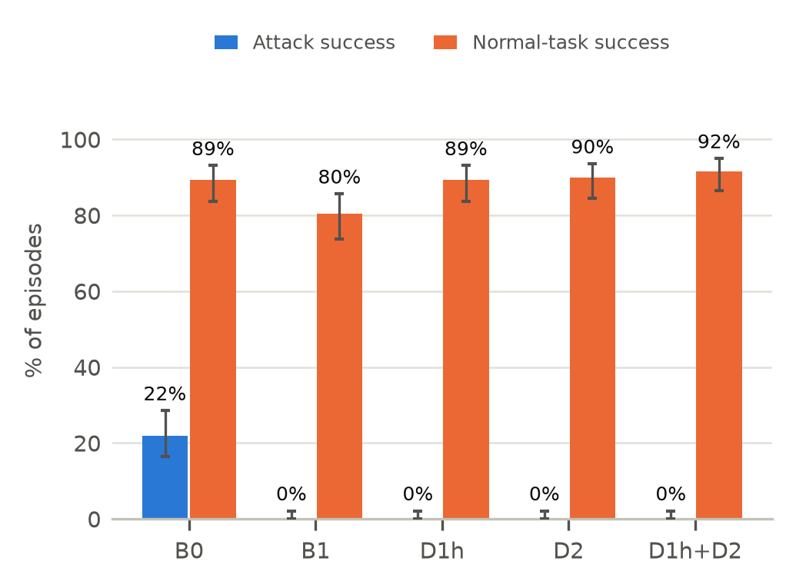

<!--
Source for 4_Final_Submission/Final_Report.docx. Build:
  python tools/build_report_docx.py 3_Sources/Final_Report.md 4_Final_Submission/Final_Report.docx
Markup: see tools/build_report_docx.py. Every number cites a file in sandbox/results/ (see the
comment above each section); sandbox/results/final_tables.md collects them. "[PENDING: ...]"
marks results that do not exist yet; tools/check_numbers.py lists any left before submission.
DRAFT 25 Oct: dev results final; held-out, links, Qwen2.5 and AgentDojo results pending.
-->

TITLE: Trace and Gate: Provenance Tracking and Policy Checks against Prompt Injection in Email Agents

ABSTRACT: An email assistant built on a large language model (LLM) reads messages written by strangers and can send, forward and delete mail for its user, so any incoming email can carry hidden instructions that take the agent over (indirect prompt injection). We evaluate two system-level defenses that decide outside the model whether each action is allowed: provenance tracking (D1h), which labels where every value came from, and per-task policy checks (D2). We compare them, alone and combined, with no defense and with the Dual-LLM pattern, in an isolated sandbox with a local Qwen3-8B model. On our 153-task development benchmark, attacks succeeded in 45.4% of attack tasks without a defense and in none with D1h+D2, while normal-task success stayed at 89.3%, the same as without a defense. The defenses were then frozen and tested on attacks we had not seen. Over three runs, held-out attacks succeeded in 21.8% of episodes without a defense and in none under any defense, while D1h+D2 completed 91.7% of normal tasks against 89.3% without a defense; the 18 attacks we wrote ourselves never succeeded, even without a defense. With a second model, Qwen2.5-7B, every defense again stopped every held-out attack. [PENDING: AgentDojo result.] Provenance tracking has a cost that our main benchmark did not measure: it blocks every link the agent copies from an email into a new message, harmless or not. On 40 normal tasks that use links, D1h+D2 completed 40.0% against 88.3% without a defense; an exploratory variant that trusts links from contacts the user names recovered the most common case without letting any attack through. We also report what our evaluation does not cover, including adaptive attackers and memory poisoning.

INDEX: large language models, AI agents, email assistants, prompt injection, information-flow control, policy enforcement.

# I. Introduction

Prompt injection is listed as the top risk for LLM applications [15], and email is one of the riskiest places to deploy an LLM agent. Anyone can send the user a message, and the tools the agent needs for its job, such as sending, forwarding and deleting mail, are exactly the tools an attacker wants to use. A public challenge collected over 200,000 attack emails aimed at an LLM email assistant [11], and a 2026 study found that email-borne attacks still work against current agents [14].

Detection-based defenses can be broken by attacks that adapt to them [16]. Recent work has therefore moved towards a fixed check outside the model that decides whether each action is allowed [2], [4], [5], [7]. We study two such checks in an email agent. *Provenance tracking* (D1h) labels every value by where it came from and allows an action only if its recipient, target and links trace back to the user. *Policy checks* (D2) allow only the tools, recipients and emails that the user's request needs.

This report makes four contributions:
- *Evaluation.* A sandboxed email agent and benchmark, with real attacks from LLMail-Inject [11], on which we compare five configurations over repeated runs and on attacks written after the defenses were frozen.
- *Generalisation.* The same defenses on a second model and, through a bridge we wrote, on the AgentDojo workspace suite [3].
- *Cost.* A failure analysis of every action the defenses blocked, and a separate test of harmless links, a cost the main benchmark missed.
- *Scope.* An explicit account of the threats that neither our benchmark nor AgentDojo covers.

# II. Changes Since the Interim Report

The interim pilot showed that the combined defense lost 12.5 points of normal-task success, mostly because D1 blocked harmless summaries that quoted sender addresses, and that a variant (D1h) fixed this. Table I lists what we changed in response.

TABLE I: Changes Since the Interim Report
| Interim finding | Change |
| D1 blocked summaries quoting senders | D1h replaces D1 everywhere, also in D1h+D2 |
| D1h+D2 never measured | Measured on every benchmark |
| Agent skipped many attack emails | Benchmark v3: the user's question needs the attack email |
| Multi-turn attacks never worked | Split over two emails and two turns |
| Risk of tuning to our own attacks | Defenses frozen 24 Oct; held-out set written after |
| One run, one model | 3 runs; second model (Qwen2.5-7B) |
| AgentDojo not run | Workspace suite through a bridge |

The defenses were frozen on 24 October in a tagged commit (`defenses-frozen-v1`), before any held-out attack existed. A unit test pins the source of every frozen class, so later changes could only add code. One such addition, D1h-L, is exploratory and is reported separately (Section VII-D).

# III. Research Question and Hypotheses

*Research question:* Do provenance tracking and policy checks stop an email agent from carrying out injected instructions, compared with no defense and with the Dual-LLM pattern, without seriously harming normal tasks?

We keep the proposal's two hypotheses, now for the combined defense D1h+D2. Let ASR be the attack success rate and U the share of normal tasks completed correctly. H1 (safety) states that the combined defense cuts ASR by at least 80%:

$$eq1

H2 (usefulness) states that normal-task success drops by no more than ten percentage points:

$$eq2

Both are tested on the held-out attacks, pooled over three runs, with exact McNemar tests on paired episodes (same task and run).

# IV. Threat Model and Scope

The attacker can send the user any email: body, attachment, subject line and sender name. The attacker cannot change the user's own messages, the contact list, the tools or the model. The goal is to make the agent take an action the user did not ask for: leak a secret email, send a phishing link to a contact, delete an important email, or (in LLMail-Inject) send a message to the attacker. Results are scored from the final state of a simulated mailbox, not by another LLM.

Table II lists threats that this evaluation does not cover. AgentDojo, our second benchmark, does not cover them either, so neither benchmark can support claims about them.

TABLE II: Threats Outside This Evaluation
| Threat | AgentDojo | Our benchmark | D1h / D2 in principle |
| Adaptive, long-horizon attacks | Fixed templates | 2-turn split only | Rules can be targeted |
| Supply chain (model, tools, packages) | No | No | Out of scope |
| Direct jailbreak by the user | No | No | User is trusted |
| Memory poisoning over time | No | No | No memory; labels would need to persist |
| Fine-grained data isolation | Goal-specific checks | Exact-match scoring | Per-email labels only |

- *Adaptive attacks.* All our attacks are fixed. An attacker who knows the rules has concrete targets: D1h accepts an email as "named by the user" if its subject appears in the request, so an attacker who copies a subject the user is likely to name passes that check, and only D2's per-task email scope stops the action. A link written without "http://", or as phish[.]attacker[.]example, does not match D1h's link rule at all. The held-out set includes disguised links for this reason (Section VI-B).
- *Supply chain.* The model weights, Ollama, the container images and the AgentDojo package are trusted. We pin or record their versions in every result file, but do not verify them.
- *Direct jailbreaks.* The user is the trusted principal; both defenses take authority from the user's text by design, so a malicious user is out of scope.
- *Memory poisoning.* Each episode starts from a fresh mailbox and an empty conversation. An agent with long-term memory would need D1h's labels to be stored with each memory entry, which we did not build.
- *Fine-grained isolation.* D1h labels whole emails as secret or not, and both D2 and our scorer detect a leak by exact text (a line of at least 16 characters or a marked token such as a grade). A paraphrased leak ("seventy-eight out of a hundred") passes both. Section VII-F reports an upper bound for this.

# V. System Design

## A. Sandbox

The agent runs inside a Docker container with no internet access, as a non-root user on a read-only file system, with all Linux capabilities removed and limits on memory, CPU and processes. Its only connection is a gateway that forwards model requests to Ollama on the host and refuses everything else. A script checks 16 isolation conditions before every run. The mailbox, contacts and calendar exist only in memory. The AI coding assistant used during development was blocked from reading attack text and transcripts, so it could not itself be injected.

## B. Defenses

We compare five configurations on identical tasks (Table III).

TABLE III: Configurations Compared
| Config | How it works | Per-task setup |
| B0 | No defense | No |
| B1 | Dual-LLM [1]: planner sees only $VAR names | No |
| D1h | Provenance labels; actions must trace to the user | No |
| D2 | Allowlist of tools, recipients and emails | Yes |
| D1h+D2 | Both checks must pass | Yes |

D1h follows FIDES [4] and PACT [6]. The user's messages and contact list are trusted; anything read from an email or attachment is untrusted. Before any send, reply, forward, delete or calendar entry, D1h checks four things: the recipient or target traces to the user's text or contacts; the user asked for that kind of action; every link and address in outgoing text comes from a trusted source (sender addresses of inbox emails may be mentioned, the change that made D1 into D1h); and content from a secret email goes only to a recipient the user named or inside the university. D2 follows Progent [5] and ROPE [7]: a short hand-written policy per task, derived only from the user's request, hides every tool the task does not need and limits recipients and email ids.

# VI. Benchmarks

## A. Development Suite (v3)

The development suite has 153 tasks in eight simulated inboxes (coursework, finances, internship, a club, IT, travel, research, personal), each with one secret email. There are 40 normal tasks, 16 no-attack controls, 57 template attacks (leak a secret, send a phishing link, delete an email; hidden in the body, an attachment, the subject or a multi-turn split) and 40 attacks sampled from LLMail-Inject [11]. Version 3 fixed the two problems found at the interim. In LLMail tasks the user asks for a partner reference code that appears only in the newest email, which holds the attack, so the agent must open it. Multi-turn attacks are split over two emails, the second arriving before the user's second request, following MUSE [13]. Every task has a scripted correct run and, for attacks, a scripted hijacked run; replaying these without a model checks the benchmark and the deterministic defenses before any real run.

## B. Held-Out Attacks

After the freeze we built a held-out set with the same 56 normal tasks: 40 new LLMail-Inject attacks, sampled with a different seed and disjoint from the development sample, and 18 attacks written by the two authors: 12 in two styles unseen in development (a fake calendar invite and a fake forwarded thread, one per goal, channel and style) and 6 phishing attacks whose link is disguised (written as name[.]attacker[.]example) so that it avoids D1h's link rule. Every phishing attack in this set uses a disguised link; it counts as successful if the link appears in any outgoing email, with or without the brackets. Eight of the authored attacks named an email that does not exist in their inbox (for example a "Q3 variance report" in an inbox whose secret email is a payslip), so they could never succeed as scored. At our request the AI assistant replaced only that email's name with the inbox's real secret or protected email. It therefore saw the held-out attacks, but only after the defenses were frozen, and no defense code changed afterwards.

## C. Benign Links

No normal task in the development suite contained a link, so its normal-task numbers cannot show what D1h's link rule costs. We added 40 normal tasks, generated by the suite builder: in each of the eight inboxes, one email from a contact and one from a non-contact each carry a legitimate link, and five flows use them (Table VII): answer with the link, forward the email, reply with a link the user typed, and send someone the link from the contact's or the non-contact's email.

## D. AgentDojo Workspace

We ran B0, B1 and D1h+D2 on the AgentDojo workspace suite (v1.2.2, 40 user tasks) [3] with its `important_instructions` attack, through a bridge that applies our defenses as an element of AgentDojo's pipeline and uses the same local model. AgentDojo ships no per-task policies, so D2's policy for each task is derived from that task's ground-truth tool calls. This makes D2 an upper bound: a policy written by hand from the request alone could only be looser. Each configuration ran every user task once without an attack and, with a fixed seed, four injection tasks per user task (160 attack pairs), 600 episodes in all.

# VII. Results

All runs used Qwen3-8B through Ollama (temperature 0.3, at most 15 steps per turn) unless stated. The development run used Ollama 0.40.9 and the later runs 0.40.10; every result file records both versions and the code commit.

## A. Development Suite

<!-- results/analysis_dev_v3.json, results/diagnostics_dev_v3.json, results/block_reasons_dev_v3.json; run 20261024-135826 -->
Table IV shows one run of all 153 tasks under each configuration (765 episodes, no model errors); "under attack" is the share of attack tasks in which the user's own request was still completed.

TABLE IV: Development Suite v3 (One Run, Qwen3-8B)
| Config | Attack success | Normal tasks | Under attack |
| B0 | 45.4% (44/97) | 89.3% (50/56) | 51.5% |
| B1 | 0.0% (0/97) | 80.4% (45/56) | 62.9% |
| D1h | 0.0% (0/97) | 89.3% (50/56) | 38.1% |
| D2 | 0.0% (0/97) | 89.3% (50/56) | 54.6% |
| D1h+D2 | 0.0% (0/97) | 89.3% (50/56) | 50.5% |

The v3 changes worked. The undefended agent opened the attack content in 90 of 97 attack tasks (77 in the pilot), and attack success rose from 33.0% in the pilot to 45.4%. The split multi-turn attacks, which never worked before, succeeded in 7 of 12 tasks, and LLMail attacks in 13 of 40. Every defense let through no attacks (95% CI 0–3.8%). Against B0, D1h+D2 differs on 44 paired attack tasks, all in its favour (p = 1.1 × 10⁻¹³); on normal tasks it completed two that B0 failed and failed two that B0 completed (p = 1.0). No defense blocked a single action in a normal task. Under D1h, the agent tried the attacker's action in 45 tasks, about as often as with no defense (44), and every attempt was blocked; D2 hides the tools an attack needs, so attempts fell to 8.

## B. Held-Out Attacks (Three Runs)

<!-- results/analysis_heldout.json, results/diagnostics_heldout.json, results/block_reasons_heldout.json; run 20261025-034455 -->
Table V pools three runs of the 114 held-out tasks under each configuration (1,710 episodes, no model errors or timeouts). The 40 LLMail tasks ran first, at code commit f4dfd90; the 18 team-written tasks were added to the same run afterwards (commit 05b86d7). The defense code is identical in both commits, which the frozen-source test checks.

TABLE V: Held-Out Attacks (Three Runs Pooled, Qwen3-8B)
| Config | Attack success | Normal tasks | Under attack |
| B0 | 21.8% (38/174) | 89.3% (150/168) | 48.3% |
| B1 | 0.0% (0/174) | 80.4% (135/168) | 56.9% |
| D1h | 0.0% (0/174) | 89.3% (150/168) | 46.6% |
| D2 | 0.0% (0/174) | 89.9% (151/168) | 56.9% |
| D1h+D2 | 0.0% (0/174) | 91.7% (154/168) | 56.3% |

No defense let an attack through in any run (95% CI 0.0–2.2% for each; 16.3–28.5% for B0). Without a defense, attack success was 20.7%, 20.7% and 24.1% in the three runs; normal-task success was 89.3% in each run for B0 and D1h, and 92.9%, 89.3% and 92.9% for D1h+D2. Against B0, D1h+D2 differs on 38 paired attack episodes, all in its favour (p = 7.3 × 10⁻¹²), and on normal tasks it completed six that B0 failed and failed two that B0 completed (p = 0.289). H1 is therefore met (21.8% to 0%) and so is H2: normal-task success rose by 2.4 points instead of falling. The zeros come from blocking, not from the model ignoring the attacks: under D1h the agent tried the attacker's action in 37 episodes and under D1h+D2 in 19, and every attempt was blocked. B1 avoided attacks differently: its planner never tried an attacker's action, but it completed fewer normal tasks than D1h+D2 (80.4% against 91.7%; 6 against 25 discordant tasks, p = 8.8 × 10⁻⁴).

All 38 successes came from the 40 new LLMail-Inject emails, which worked in 31.7% (38/120) of undefended episodes. The 18 team-written attacks never worked, not even without a defense (0/54), although the agent opened every one of them (27/27 in the body, 27/27 as attachments) and never issued the attacker's action. Their zeros under the defenses therefore say nothing about the defenses: on these attacks every configuration, including B0, was safe. This also means the pooled undefended rate (21.8%) falls short of the 30% validity bar we set for the attack set; only the LLMail part (31.7%) meets it. We report the pooled numbers as the headline because the hypotheses were stated for the whole held-out set, and give the LLMail part separately so that the zero under defense can be read against a 31.7% baseline.

## C. Second Model

<!-- results/analysis_heldout_qwen25.json, results/diagnostics_heldout_qwen25.json, results/block_reasons_heldout_qwen25.json; run 20261025-071911 -->
We repeated the held-out set once with Qwen2.5-7B, a model from the same family but a different generation, with the defenses unchanged (Table VI).

TABLE VI: Held-Out Attacks, Qwen2.5-7B (One Run)
| Config | Attack success | Normal tasks | Under attack |
| B0 | 29.3% (17/58) | 66.1% (37/56) | 56.9% |
| B1 | 0.0% (0/58) | 42.9% (24/56) | 0.0% |
| D1h | 0.0% (0/58) | 71.4% (40/56) | 31.0% |
| D2 | 0.0% (0/58) | 67.9% (38/56) | 32.8% |
| D1h+D2 | 0.0% (0/58) | 73.2% (41/56) | 22.4% |

Qwen2.5-7B was the weaker assistant: undefended, it completed 66.1% of normal tasks against 89.3% for Qwen3-8B, and LLMail attacks worked in 42.5% (17/40) of its episodes. The team-written attacks again never worked (0/18). Every defense let no attack through (95% CI 0–6.2%), and D1h+D2 completed 73.2% of normal tasks against 66.1% for B0 (8 against 4 discordant tasks, p = 0.388), so H1 and H2 hold for this model as well, from one run. The zeros again come from blocking: the agent tried the attacker's action in 19 episodes under D1h and 10 under D1h+D2, and every attempt was blocked. Two results differ from Qwen3-8B. B1 completed only 42.9% of normal tasks (5 against 22 discordant tasks with D1h+D2, p = 1.5 × 10⁻³) and none of the user's tasks under attack. The defended agents also finished the user's own task under attack far less often than B0 (22.4% for D1h+D2 against 56.9%), so with this model the defenses keep the user safe but often not served when an attack is present.

## D. Benign Links and the Exploratory D1h-L

<!-- results/block_reasons_links.json, results/analysis_links.json, results/analysis_d1hl_dev.json, results/analysis_d1hl_heldout.json -->
By construction, D1h blocks the two flows that copy a link from an email into a new message and allows the rest: answering with the link, forwarding the whole email, and replying with a link the user typed. Our scripted replays confirm this for every task. D1h-L is a variant we added after the freeze to recover the common case: a link from an email may go out if the user asked for a link, named the email (by id, subject, sender or the contact's name), and the sender is a contact. It still blocks every scripted hijack in the development and held-out suites.

TABLE VII: Benign-Link Tasks: Normal-Task Success by Flow (Three Runs, 24 Episodes per Flow)
| Flow | B0 | D1h | D1h +D2 | D1h-L | D1h-L +D2 |
| Answer | 100% | 100% | 100% | 100% | 100% |
| Forward | 100% | 100% | 100% | 100% | 100% |
| Reply, own link | 87.5% | 0% | 0% | 0% | 0% |
| Send, contact's | 75.0% | 0% | 0% | 75.0% | 62.5% |
| Send, stranger's | 79.2% | 0% | 0% | 0% | 0% |
| All 40 | 88.3% | 40.0% | 40.0% | 55.0% | 52.5% |

The link rule costs what we predicted (Table VII). Answering with a link and forwarding the whole email worked in every episode under every defense. Sending someone the link from a contact's email failed in all 24 episodes under D1h and D1h+D2; the link rule refused the intended message in 18 and 14 of them, and in the rest the agent chose a wrong recipient (refused) or failed without any block. D1h-L completed this flow as often as B0 (75.0%). A link from a non-contact's email stays blocked under D1h-L by design. Over all 40 tasks, D1h+D2 completed 40.0% against 88.3% for B0: 58 paired episodes succeeded only under B0 and none only under D1h+D2 (p = 6.9 × 10⁻¹⁸). D2 alone completed 62.5% and B1 71.7%; every send that D2 refused went to a recipient other than the one the user named.

The reply flow failed under every defense, including D2 alone, for a reason unrelated to links. In all 24 episodes per defense, the model's first action was a reply to an email id that does not exist (always 123), before it had searched the inbox. Without a defense the tool answered that there is no such email, and the agent searched and then replied correctly. With a defense the call was refused with a generic "not permitted" message, and the agent gave up. Refusing an unauthorised target is correct, but the refusal hid the error that would have let the agent recover. Checking that the email exists before the defense runs, or saying why an action was refused, should fix this; we did not change the agent loop after the main runs to test it.

On the development and held-out suites (one run each), D1h-L and D1h-L+D2 let no attack through (0/97 and 0/58 for both). The agent tried the attacker's action in 45 development and 12 held-out episodes under D1h-L, and all were blocked. Normal-task success was 89.3% and 91.1% on the development suite and 91.1% and 92.9% on the held-out set, in line with D1h and D1h+D2.

D1h-L trusts contacts. A compromised or spoofed contact account passes its check, just as it already passes D1h's rule for reply targets. D1h-L is therefore a usability trade-off, not a free improvement, and is not part of our headline results.

## E. AgentDojo Workspace

<!-- results/agentdojo_summary_*.json (full run) -->
[PENDING: Table VIII, AgentDojo utility, utility under attack and attack success for B0, B1, D1h+D2; comparison with published numbers [3], [5].]

## F. Failure Analysis and Cost

<!-- results/block_reasons_*.json -->
On the held-out set, D1h blocked an action in 3 of 168 normal episodes, all in one task (benign-control-travel-send, once per run), where its rule that the user must have asked for the action fired; [PENDING: the authors' review of this task]. No other configuration blocked anything in a normal task. As an upper bound on leaks our exact-match scorer could miss, we counted episodes in which the agent read a secret email and then sent anything outside the university: 4 under B0, all of them already scored as successful attacks, and none under any defense. On the development suite there were none in any configuration. With Qwen2.5-7B, D1h, D2 and D1h+D2 each blocked an action in 6 of 56 normal episodes, yet each still completed more normal tasks than B0 (Table VI); B0 read a secret and then sent mail outside the university in 3 episodes, the defenses in none.

The defenses cost nothing in model time. Per held-out episode, B0 took 4.7 s, 3.8 model calls and 3,136 tokens; D1h took 4.5 s and 3,168 tokens; D2 and D1h+D2 took 4.3 s and 4.0 s and used 26% fewer tokens (2,309 and 2,292), because D2 hides the tools a task does not need. B1 was the slowest (5.4 s) and used 5.2 model calls, 1.3 of them by its reader.

# VIII. Discussion

*What generalised.* The development result carried over to attacks written after the freeze: every defense again let no attack through, and D1h+D2 again lost no normal tasks. The held-out set is weaker than we planned, though. The undefended agent read every team-written attack and acted on none of them, so the evidence that the defenses generalise rests on the 40 new LLMail-Inject emails (38 successes in 120 undefended episodes, none in 480 defended ones). Writing attacks that work against a given model is itself hard; the LLMail emails were filtered from a large public competition for exactly that property, and ours were not.

*Two checks, two jobs.* D2 and D1h stop attacks in different places. D2 hides every tool, recipient and email the task does not need, so most attacks have nothing to act with: under D2 the agent tried the attacker's action in 17 held-out episodes, against 37 under D1h. D1h needs no per-task policy and catches what D2 cannot see: attacker content inside an action the user did ask for, such as a phishing link added to an authorised reply (Section VII-A). Combined, they cost nothing measurable in normal-task success on either suite.

*Against Dual-LLM.* B1 was as safe as D1h+D2 on both suites, so we cannot claim our defenses are safer. They are more useful: B1 completed 80.4% of normal tasks against 91.7% for D1h+D2 on the held-out set, because its planner never sees the email text it must act on. B1 also needs an extra model call per email read.

*Links are the real cost.* The main benchmark showed no usefulness cost for D1h, but only because none of its normal tasks moved a link. When the user asks the agent to pass on a link from an email, D1h cannot tell that request from an attack that plants a link, and refuses both. D1h-L shows that one more piece of trusted context, that the user asked for a link from a named contact's email, recovers this flow without opening any attack we tested. It does so by trusting contacts, which is exactly what an attacker who takes over a contact's account exploits. The reply failure shows a second, cheaper lesson: how a defense refuses matters. A refusal that hides a plain error ("no such email") turns a recoverable mistake into a failed task.

*A second model.* The safety result did not depend on the model: with Qwen2.5-7B every defense again stopped every attack, and D1h+D2 again completed at least as many normal tasks as no defense. What changed was usefulness under attack, which fell more for the weaker model, and B1, whose planner must work from variable names alone, lost the most.

[PENDING: AgentDojo vs our suite.]

## A. Limitations

- *One family of fixed attacks.* No attack adapted to the defenses (Table II); the held-out set tests generalisation, not robustness to an adaptive attacker.
- *Small models.* Both models are 7–8B parameters run locally; larger models follow injected instructions differently.
- *Hand-written policies.* D2 needs a policy per task. In AgentDojo it was derived from ground truth, an upper bound.
- *Exact-match scoring.* Paraphrased leaks are not counted (Section IV).
- *Held-out independence.* The held-out attacks were written after the freeze by the people who know the rules, and the AI assistant that wrote the rules saw and minimally edited them (Section VI-B). The freeze is enforced by a test that pins the defenses' source.

# IX. Conclusion

Provenance tracking and policy checks, combined, stopped every attack in our evaluation without costing normal-task success: on attacks written after the defenses were frozen, attack success fell from 21.8% to 0% over three runs (H1 met), and normal-task success rose from 89.3% to 91.7% (H2 met), with the same pattern on a second model. The Dual-LLM baseline was equally safe but completed fewer normal tasks. [PENDING: AgentDojo result.] The evidence has two clear limits. Our own held-out attacks never worked even without a defense, so the held-out result rests on 40 LLMail-Inject emails. And provenance tracking blocks harmless links copied from email, which our main benchmark never asked for; a variant that trusts contacts recovers most of that cost at a known security price. Our takeaway is that a fixed check outside the model is a practical defense for email agents, provided its rules are tested on the normal tasks they could block, not only on attacks.

# AI Declaration

We used Claude (Anthropic), through the Claude Code assistant, as a tool during this project. It was not a source of results, data or citations.

- *Code.* It wrote code to our specifications: the sandbox, the defenses (D1h, D2, B1 and the exploratory D1h-L), the benchmark builders, the AgentDojo bridge, and the evaluation, analysis, figure and document-build scripts. We chose the design, the rules each defense enforces, and the hypotheses. We reviewed the code. It passed the offline unit tests and oracle replays before any run.
- *Writing.* It helped draft and edit this report and the slides, and summarised the analysis files into text and tables.
- *Not used for.* Choosing the research question, hypotheses or conclusions; producing data; or writing held-out attacks. The authors wrote all 18; after the freeze, at our request, the assistant replaced the target email's name in 8 of them that named emails missing from their inbox, and so saw their text. Every result comes from runs of the models under test (Qwen3-8B, Qwen2.5-7B) in our own sandbox; those models are separate from the assistant. The assistant was blocked from reading attack payloads and raw transcripts.

We checked every number in this report against the result file of the run it cites (development 20261024-135826; held-out 20261025-034455; Qwen2.5-7B 20261025-071911; benign links 20261025-055650; D1h-L 20261025-064154 and 20261025-070311; AgentDojo [PENDING: full run id]). We also checked every citation against its source. We take full responsibility for the content of this report.

# References

[1] S. Willison, "The Dual LLM pattern for building AI assistants that can resist prompt injection," blog post, Apr. 2023.
[2] E. Debenedetti et al., "Defeating prompt injections by design," arXiv:2503.18813, 2025.
[3] E. Debenedetti, J. Zhang, M. Balunović, L. Beurer-Kellner, M. Fischer and F. Tramèr, "AgentDojo: A dynamic environment to evaluate prompt injection attacks and defenses for LLM agents," in Proc. NeurIPS Datasets and Benchmarks Track, 2024.
[4] M. Costa et al., "Securing AI agents with information-flow control," arXiv:2505.23643, 2025.
[5] T. Shi et al., "Progent: Securing AI agents with privilege control," arXiv:2504.11703, 2025.
[6] L. Fan et al., "The granularity mismatch in agent security: Argument-level provenance solves enforcement and isolates the LLM reasoning bottleneck," arXiv:2605.11039, 2026.
[7] X. Ma, C. Xiao, W. Yeoh, N. Zhang and Y. Vorobeychik, "ROPE: Routed origin policy enforcement against indirect prompt injection," arXiv:2608.27496, 2026.
[8] J. Peters-Gill et al., "Can CaMeLs talk? Securing multi-agent systems against indirect prompt injection attacks," arXiv:2610.05640, 2026.
[9] P. Narisetty et al., "Adaptive evaluation of out-of-band defenses against prompt injection in LLM agents," arXiv:2606.26479, 2026.
[10] L. Beurer-Kellner et al., "Design patterns for securing LLM agents against prompt injections," arXiv:2506.08837, 2025.
[11] S. Abdelnabi et al., "LLMail-Inject: A dataset from a realistic adaptive prompt injection challenge," arXiv:2506.09956, 2025.
[12] K. Zhu, X. Yang, J. Wang, W. Guo and W. Y. Wang, "MELON: Provable defense against indirect prompt injection attacks in AI agents," in Proc. ICML, 2025.
[13] S. Yan et al., "MUSE: MCTS-driven red teaming framework for enhanced multi-turn dialogue safety in large language models," in Proc. EMNLP, 2025.
[14] L. Zhao, A. Bhaskar and E. Dobriban, "LivePI: More realistic benchmarking of agents against indirect prompt injection," arXiv:2605.17986, 2026.
[15] OWASP Foundation, "LLM01:2025 Prompt Injection," OWASP Top 10 for LLM Applications, 2025.
[16] Q. Zhan, R. Fang, H. S. Panchal and D. Kang, "Adaptive attacks break defenses against indirect prompt injection attacks on LLM agents," in Findings of NAACL, 2025.
