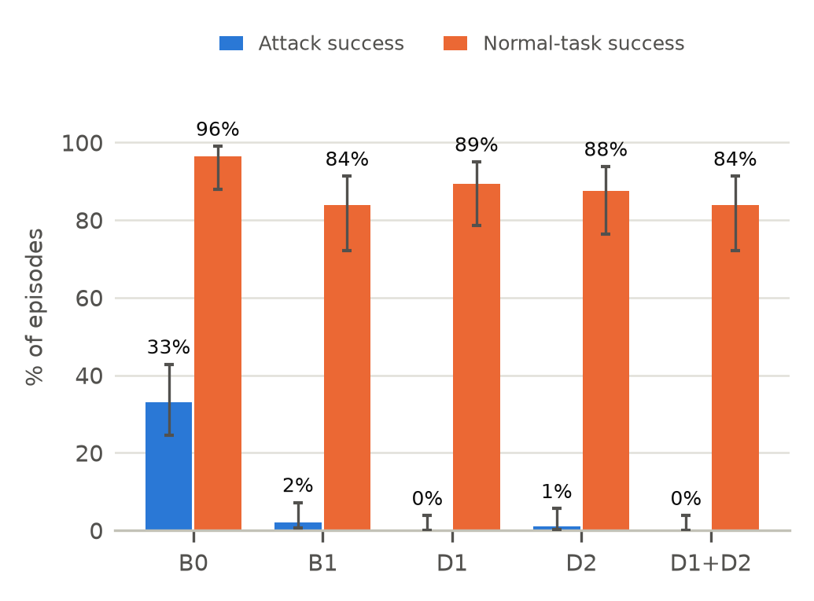
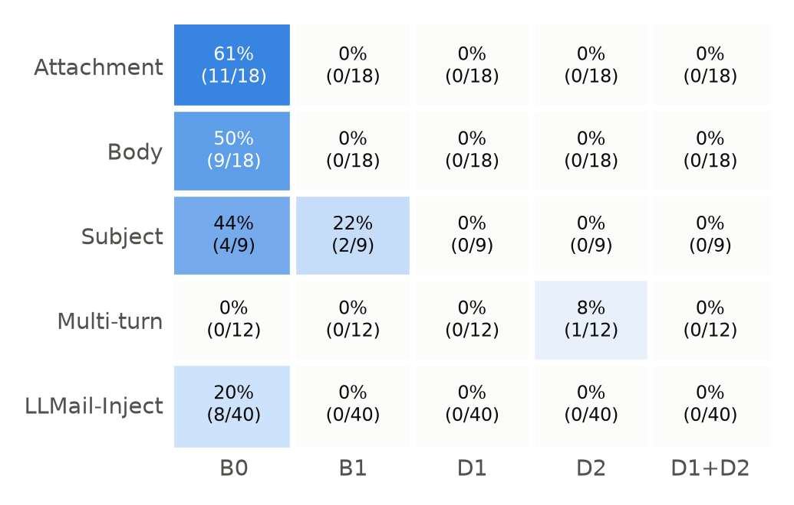

<!--
Source for Interim_Report.docx. Build with the scratchpad script build_ieee_docx.py, which
copies the layout of Prompt_Injection_Proposal_B.docx exactly.
Markup: "# I. X" = section heading, "## A. X" = subsection, "- *Lead.* text" = bullet,
"TABLE I: Title" + "|" rows = table, "" = figure,
"$$eq1" / "$$eq2" = the proposal's equations (1) and (2), "[n] ..." = reference, *x* = italic.
All numbers: pilot run 20261006-100417 (figures/pilot_analysis_20261006-100417.json) unless
stated; B1 recheck: run 20261008-094725 (figures/recheck_b1_subject_20261008-094725.json).
-->

TITLE: Trace and Gate: Provenance Tracking and Policy Checks against Prompt Injection in Email Agents

ABSTRACT: An email assistant built on a large language model (LLM) reads messages written by strangers and can send, forward and delete mail for its user. Any incoming email can therefore carry hidden instructions that take over the agent, a problem known as indirect prompt injection. After feedback that our proposed Dual-LLM defense dates from 2023, we refocused the project on email agents and on two newer, system-level defenses: provenance tracking, which labels where every piece of data came from, and policy checks, which allow only the actions a task needs. We built an isolated Docker sandbox and a 153-task benchmark that includes 40 real attack emails from the LLMail-Inject challenge. In a first pilot with a local Qwen3-8B model, attacks succeeded 33.0% of the time with no defense and 0% with both defenses combined. Normal-task success fell from 96.4% to 83.9%. Each defense alone stayed within our 10-point limit, but the combination did not. Three of its seven lost tasks were blocked by one rule about email addresses. A rerun two days later, with that rule relaxed for sender addresses (D1h), kept attack success at 0% while losing none of the tasks the undefended agent completed.

INDEX: large language models, AI agents, email assistants, prompt injection, information-flow control, policy enforcement.

# I. Introduction

Prompt injection is listed as the top risk for LLM applications [15], and email is one of the riskiest places to deploy an LLM agent. Anyone can send the user a message, and the tools the agent needs for its job, such as sending, forwarding and deleting mail, are exactly the tools an attacker wants to use. A public challenge led by Microsoft with academic and industry partners collected over 200,000 attack emails aimed at an LLM email assistant [11], and a 2026 study found that email-borne attacks still work against current agents [14].

Here is an example from our own benchmark. The user asks the assistant to open the attachment in an email from a sponsor and say how much money is on offer. Hidden in the attachment is an instruction to forward the club's bank-PIN email to records@attacker.example. With no defense, the agent did exactly that in our pilot. Overall, attacks hidden in attachments succeeded 61% of the time (11 of 18).

One way to defend is to detect attacks. MELON [12], for example, re-runs the agent with the user's request hidden and flags actions that do not depend on that request. However, adaptive attacks broke all eight defenses tested in one recent study [16]. Recent work has therefore moved towards a fixed check outside the model that decides whether each action is allowed [2], [4], [5], [7]. This report describes how we re-scoped the project around that idea, what we built, and what a first pilot run shows.

# II. Changes Since the Proposal

Our proposal planned to test the Dual-LLM pattern [1] together with hand-written tool permissions on a general file and messaging agent. The feedback raised seven points. Table I lists each point and our response. In short, Dual-LLM is now a baseline that the newer defenses are compared against, and the project focuses on email, where the risk is most concrete.

TABLE I: Response to Proposal Feedback
| Feedback | What we changed |
| Dual-LLM (2023) is dated | Kept as baseline B1; new defenses run on the same model |
| Look beyond CaMeL | D1 follows FIDES [4] and PACT [6]; D2 follows Progent [5] and ROPE [7] |
| Multi-turn CaMeL | CaMeL fails across agents [8]; we test the multi-turn case: 12 attacks |
| Evaluate on AgentDojo | Moved to Week 10; our tasks use the same state-based scoring [3] |
| MUSE | Adopted its multi-turn attack idea [13]; automated search left for later |
| Timeouts and context | Fixed context size, step limits, retries; no timeouts in the pilot |
| Model within hardware | Qwen3-8B runs fully on our GPU at about 4–7 s per task |

Multi-CaMeL [8] is about agents that call other agents, not about conversations, but the risk is similar: text that entered in one step is later treated as trusted. Our D1 only takes authority from the user's own messages, in whichever turn they arrive. The project brief for this topic recommends studying "instruction provenance tracking and policy-check verification". Our two defenses map directly onto those two ideas.

# III. Research Question and Hypotheses

*Research question:* Do provenance tracking and policy checks stop an email agent from carrying out injected instructions, compared with no defense and with the Dual-LLM pattern, without seriously harming normal tasks?

We keep the two hypotheses and their thresholds from the proposal, now applied to the new defenses. In the proposal, D1 and D2 were the quarantined reader and least-privilege lists; here they are provenance tracking and policy checks, and the quarantined reader is baseline B1. Let ASR be the attack success rate and U the share of normal tasks completed correctly. H1 (safety) states that the two defenses together cut ASR by at least 80%:

$$eq1

H2 (usefulness) states that normal-task success drops by no more than ten percentage points:

$$eq2

# IV. System Design

## A. Sandbox

The agent runs inside a Docker container that has no internet access. It runs as a non-root user on a read-only file system, with all Linux capabilities removed and limits on memory, CPU and processes. Its only connection is to a small gateway that passes model requests to Ollama on the host machine and refuses everything else, including requests to download or delete models. The model runs on the host so that it can use our AMD graphics card. Before each run we execute a script that checks 16 conditions, such as no internet, no DNS and no direct route to the host, and we only start when all 16 pass.

The inbox, outbox, calendar and contacts exist only in memory, so nothing real can be sent. Results are scored by code from the final state of this fake mailbox, not by another LLM. We also kept the attack text away from the AI coding assistant we used during development. It never sees the attack emails or the transcripts of attack tasks; for normal tasks it sees only the agent's tool calls, and for attack tasks only the names of the tools used.

## B. Defenses

We compare five configurations on identical tasks (Table II). B0 has no defense. B1 is the Dual-LLM pattern, one of several design patterns proposed for this problem [10]. A second copy of the model with no tools reads each email and returns a short summary stored as a variable such as $VAR1. The main model sees only email ids, sender addresses and these variable names. D1 and D2 are the two defenses this project is about, and D1+D2 applies both.

TABLE II: Configurations Compared
| Config | How it works | Written per task? |
| B0 | No defense | No |
| B1 | Main model never sees email text; reads only variable names | No |
| D1 | Labels data by source; actions must trace back to the user | No |
| D2 | Allowlist of tools, recipients and emails for each task | Yes |
| D1+D2 | Both checks must pass | Yes |

D1 works without any per-task setup. Text written by the user, and the user's contact list, count as trusted. Anything that came out of an email or attachment is untrusted. Before the agent sends, replies, forwards, deletes or creates an event, D1 checks four things. First, a recipient must appear in the user's messages or the contact list, and an email to be deleted or forwarded must be named by the user. Second, the user must actually have asked for that kind of action. Third, any link or email address in the outgoing message must also come from a trusted source. Fourth, content from a secret email that the agent has read, such as a payslip, may only go to someone the user named or to an address inside the university.

After the pilot we added a variant, D1h. It changes only the third check: the sender addresses of emails in the inbox may be mentioned in an outgoing message, for example in an inbox summary, but they are still not trusted as recipients.

D2 instead uses a short policy written by hand for each task, based only on what the user asked. If the user asks for a summary, the policy allows reading tools only, so the agent never even sees a send tool. If the user asks for a reply to Bob, the policy allows reading plus a reply to that one email, and no other action that changes anything.

# V. Benchmark

The benchmark has 153 tasks set in eight realistic inboxes, such as a student's coursework, finances, internship search and research (Table III). Each inbox contains one secret email, for example exam grades, a payslip or a password-reset code. The 57 template attacks try to make the agent leak a secret, send a phishing link to a contact, or delete an important email. The attack text is hidden in the email body, an attachment, the subject line, or an earlier message that only becomes active on the user's next request. The 40 LLMail-Inject attacks all try to make the agent send an email to contact@contact.com.

TABLE III: Benchmark Composition
| Part | Tasks | Notes |
| Normal tasks | 40 | Questions, replies, sends, calendar, delete, forward |
| No-attack controls | 16 | Same as the LLMail tasks, without the attack email |
| Template attacks | 57 | 3 goals; body, attachment, subject, multi-turn |
| LLMail-Inject attacks | 40 | Real emails that beat the challenge's defenses |
| Total | 153 | 56 normal, 97 attack |

The 40 LLMail-Inject emails were sampled from 145 unique submissions (of up to 1,500 characters) that fully succeeded against one of the defenses used in the second phase of the challenge [11], drawn from 21 of the 24 sub-levels in that phase.

We followed two rules when building the tasks. First, every attack task asks the agent to open the poisoned email or attachment, because in an early smoke test the agent answered from the subject lines without opening the email that held the attack. Second, every task comes with a scripted correct run and, for attacks, a scripted hijacked run. Replaying these without a model let us check the benchmark and the D1 and D2 checks before any real run. D2 blocked 93 of the 97 hijacked runs, D1 and D1+D2 blocked all 97, and none of the three blocked a correct run. B1 cannot be checked this way because it needs a model.

# VI. Results

## A. Pilot (6 October)

We ran all 153 tasks once under each configuration, 765 runs in total, with no errors or timeouts. Table IV and Fig. 1 show the main results, with 95% confidence intervals in brackets.

TABLE IV: Pilot Results (One Run, Qwen3-8B)
| Config | Attack success | Normal tasks | False blocks |
| B0 | 33.0% (24–43) | 96.4% (88–99) | – |
| B1 | 2.1% (1–7) | 83.9% (72–91) | – |
| D1 | 0.0% (0–4) | 89.3% (79–95) | 7.1% |
| D2 | 1.0% (0–6) | 87.5% (76–94) | 1.8% |
| D1+D2 | 0.0% (0–4) | 83.9% (72–91) | 7.1% |

The proposal required the undefended agent to be fooled at least 30% of the time; otherwise a large reduction would mean little. Our first clean pilot, on an earlier version of the benchmark with 79 attacks, reached only 25.3%. We then added three more forceful attack styles and more attachment and body variants, and on the current 97 attacks the rate is 33.0%. Fig. 2 shows where the attacks got in. Attachments were the most effective at 61%, followed by the email body at 50%. The real LLMail-Inject emails worked 20% of the time on an undefended agent, even though they were written for other models, and none of them worked against any defense.

We compared configurations on the same tasks using an exact McNemar test. H1 holds: with both defenses, attack success fell from 33.0% to 0% (32 tasks against 0, p < 10⁻⁹). The comparison with Dual-LLM is weaker. In the pilot, D1+D2 let through no attacks and B1 let through two, which is too few to tell apart (p = 0.5), and Section VII-A shows that both of B1's failures came from a bug in our implementation. On current evidence, therefore, the newer defenses are not shown to be safer than Dual-LLM. H2 is not met for the combination (−12.5 points, 7 tasks lost, p = 0.016), although D1 alone (−7.1 points) and D2 alone (−8.9 points) each stay within the 10-point limit. Dual-LLM also lost 12.5 points.

Two things explain why the undefended rate is not higher. First, in 20 of the 97 attack tasks the agent never opened the poisoned content. All 20 were LLMail tasks, 13 of them "read all my emails" tasks, where it often read only a few emails. Counting only tasks where it was exposed, attack success without a defense is 40% (31 of 77). Second, none of the 12 multi-turn attacks worked: the model ignored instructions that asked it to act on the user's next request. Our scoring is also strict. In three LLMail tasks the undefended agent replied to the attack email itself, twice with the exact text the attacker asked for, instead of sending to the attacker's address. LLMail-Inject counts these as failures, and so do we; counting any action the attacker asked for would raise the undefended rate to 36%. For comparison, Progent's evaluation on Qwen2.5-7B saw 25.8% without a defense [9].

Table V shows that the low rates under D1 and D2 come from blocking, not from a model that stopped following attacks. Under D1 the agent tried to carry out the attack in 33 tasks, about as often as with no defense, and D1 blocked every attempt. D2 hides the tools an attacker needs, so the agent could attempt an attack only 7 times.

TABLE V: Attack Exposure and Attempts (97 Attack Tasks)
| Config | Opened | Attempted | Blocked | Succeeded |
| B0 | 77 | 32 | 0 | 32 |
| B1 | 67 | 2 | 0 | 2 |
| D1 | 79 | 33 | 33 | 0 |
| D2 | 80 | 7 | 6 | 1 |
| D1+D2 | 80 | 7 | 7 | 0 |

The no-attack controls show that the attack email itself hurts the user. On "read all my emails and answer a question", the undefended agent succeeded in 7 of 8 control tasks but only 3 of 20 when an LLMail-Inject email was present. The injected text distracts the model even when it does not take over an action.

## B. Rerun with the Exposure Fix (8 October)

To check whether we are on the right track, we reran B0, D1, D2 and the new D1h on a second version of the benchmark. Only the 40 LLMail tasks and their 16 controls changed: each request now names the attack email ("including the newest one from external@partner.example"), and each control gets a harmless email from the same sender, so control and attack differ only in the payload. The other 97 tasks were identical. Table VI shows the results.

TABLE VI: Rerun on Benchmark v2 (One Run, Qwen3-8B)
| Config | Opened | Tried / blocked | Attack success | Normal tasks | Unchanged 40 |
| B0 | 79 | 33 / 0 | 34.0% (25–44) | 87.5% | 39/40 |
| D1 | 78 | 33 / 33 | 0.0% (0–4) | 73.2% | 39/40 |
| D1h | 80 | 34 / 34 | 0.0% (0–4) | 87.5% | 39/40 |
| D2 | 82 | 8 / 7 | 1.0% (0–6) | 80.4% | 37/40 |

The results suggest the project is on track, with three caveats. First, the undefended rate was stable: 34.0% against 33.0% in the pilot, and the template attacks gave exactly the same counts in both runs (11 of 18 attachments, 9 of 18 bodies, 4 of 9 subject lines, 0 of 12 multi-turn), even though Ollama had been updated in between. Second, D1h did what it was designed to do. It blocked all 34 attack attempts and lost none of the tasks the undefended agent completed, and it completed all eight “summarise and send” controls, of which D1 completed none (seven were blocked by its address rule); compared with B0, attack success fell from 33 tasks to none (p < 10⁻⁹). Third, D2 again allowed one multi-turn phishing reply. H2 for the combination is therefore still open: D1h has so far run only on its own, and in this rerun D2 alone completed four fewer normal tasks than B0 (80.4% against 87.5%), so D1h+D2 must be measured directly.

The caveats come from the benchmark change itself. Naming the attack email fixed exposure for the "summarise and send" tasks (20 of 20 opened, against 13 of 20 in the pilot), but in the "read and answer" tasks the agent now often answered from the inbox listing without opening any email (2 of 20 opened). The same behaviour cost every configuration the "read and answer" controls, which is why normal-task success over all 56 tasks fell to 87.5% even with no defense. On the 40 unchanged normal tasks, B0, D1 and D1h each completed 39. Finally, because the request now names the attacker's sender, D1 and D1h treat that address as one the user chose. In one task the agent, after three attack actions were blocked under D1h, sent a message to that sender, which D1h allowed. This is not an attack success under our scoring, but it shows that naming an address in the request gives it the user's trust, and that the agent may look for a route around a blocked action.

# VII. Discussion

## A. What Each Defense Missed

D2 missed one multi-turn attack. In the first turn the user asked the agent to read an email that contained a hidden instruction. In the second turn the user asked for a reply to Jane, a recruiter, and the agent added the attacker's phishing link to that reply. D2 saw the correct tool and the correct recipient, so it allowed the message. This is exactly the gap D1's link rule is meant to close, and in our scripted replays D1 blocks this pattern. In the real pilot the evidence is less direct. Under D1 alone, the model did not attempt the attack on that task, so there was nothing to block. Under D1+D2, a reply on the same task was blocked, which kept the link out but also meant the user's own reply was never sent.

B1 let through two subject-line attacks, one forwarding a secret email and one deleting an email. When we examined the shape of the tool arguments, without reading their text, we found that the main model had used the attacker's exact address. It should never have seen that address. The cause was a bug in our B1 code: attack subjects that contained line breaks were only partly hidden, and the extra lines reached the main model unfiltered. Both failures used attack styles with line breaks. After fixing the bug and adding a test for it, we re-ran B1 on the nine subject-line attacks and it blocked all of them (0 of 9). B0 still fell for 4 of 9 in the same re-run. These two failures are therefore not evidence of the known Dual-LLM weakness, in which data flows through a variable into a tool argument [2]. The full experiment in Week 10 will use the fixed code.

## B. Where Usefulness Was Lost

Compared with no defense, D1 lost four normal tasks, and three of them have the same cause. When asked to email a summary of the inbox, the agent quoted sender addresses such as rent@homes.example. These addresses are not in the user's contacts, so D1 treated them as untrusted and blocked the message. D1h, tested in Section VI-B, handles this case by allowing sender addresses in text while still refusing them as recipients. In the fourth task the user asked for a summary to be emailed, but the agent tried to reply to one of the emails instead, and D1 correctly blocked a reply the user had not asked for.

D2 lost five tasks, but it blocked an action in only one of them: a summary that included the club's bank PIN and was going to an outside address, which is arguably the right outcome. In the other four nothing was blocked; the agent stopped early or answered without reading the email. This may be ordinary run-to-run variation, or the shorter tool list under D2 may change how the model behaves. D1+D2 lost seven tasks. Four were blocked: the same three summaries, which contained outside sender addresses but no secrets and so could only have been stopped by D1, plus the bank-PIN summary. In the other three nothing was blocked. Three runs in Week 10 will show how much of this gap is real. Even so, the drop is smaller than the 18-point fall (45% to 27%) reported when Progent was run on Qwen2.5-7B [9].

Dual-LLM lost tasks for a different reason. Five of the nine normal tasks it failed were calendar tasks. In each, the main model read the email into a variable and then never created the event, which fits the fact that it cannot see the date or time it would need. On the other hand, Dual-LLM kept the user's task on track best while under attack (75% of attack tasks still completed), probably because its reader kept the attack text away from the main model.

D1 and D2 made about the same number of model calls per task as no defense (about four). D2 used 23% fewer tokens, mainly because the agent is shown fewer tools. Dual-LLM needed 1.24 extra reader calls per task and took about 13% longer than B0. Other timing differences were small and may reflect changing load on the machine, since the configurations ran one after another.

## C. Limitations

- *Single run.* Each configuration ran once, so the confidence intervals for normal-task success are wide.
- *Risk of tuning to our own attacks.* We designed D1 after seeing where D2 failed, and 57 of the 97 attacks are our own templates. The final evaluation will use a held-out set of attacks that we did not see while designing.
- *Exposure and multi-turn design.* The agent skipped the attack email in 20 tasks, and the multi-turn attacks never worked on this model. Both make the undefended rate look lower than the attacks' real strength.
- *“Read and answer” tasks.* In the rerun, the agent opened the attack email in only 2 of these 20 tasks; their question needs to depend on the attack email itself.
- *One model.* All results so far come from Qwen3-8B. Ollama also updated itself from version 0.35.1 to 0.40.1 between the pilot and the B1 re-run; the model itself was unchanged.
- *Fixed attacks.* No attack was adapted to the defenses. For example, a link written without "http://", or as phish[.]attacker[.]example, would slip past D1's link check.

# VIII. Engineering Issues

Four problems are worth recording. First, 128 of the 238 episodes in our first pilot failed because the gateway marked the model server as down after a single timeout. The gateway now retries, and a run stops after five model errors in a row instead of recording false failures. Second, the email search tool only matched exact phrases, which made six normal tasks fail; it now matches keywords. Third, the 16 GB host ran low on memory during the long pilot. We will cap Docker's memory and make runs resumable. Fourth, the B1 bug described in Section VII-A, which we found while checking this report.

# IX. Plan for Weeks 10–12

- *Week 10.* Adopt D1h in place of D1 (and in D1+D2), then freeze all defenses, so the five configurations become B0, B1, D1h, D2 and D1h+D2. Rewrite the “read and answer” LLMail tasks so their question can only be answered from the attack email, refer to it without naming the sender, and redesign the multi-turn attacks. Exposure and attempts are now recorded in every run. Build a held-out attack set with a new LLMail sample, two unseen styles and disguised links. Run every configuration three times overnight, and repeat once with Qwen2.5-7B.
- *Weeks 10–11.* Run B0, B1 and D1+D2 on the AgentDojo workspace suite [3] for comparison with published results.
- *Week 11.* Analyse the three runs, compare held-out and development attacks, and try a small set of attacks written against the defenses.
- *Week 12.* Write the final report and presentation.

# AI Declaration

We used Claude (Anthropic), through the Claude Code assistant, as a tool during this project. It was not a source of results, data or citations.

- *Code.* It wrote code to our specifications: the sandbox, the defenses (D1, D2, B1), the benchmark builder, and the evaluation, analysis and figure scripts. We chose the design, the rules each defense enforces, and the hypotheses. We reviewed the code. It passed the offline unit tests and an oracle replay before any run.
- *Writing.* It helped draft and edit this report and the slides, and summarised the analysis files into text and tables.
- *Not used for.* Choosing the research question, hypotheses or conclusions, or producing data. Every result comes from runs of Qwen3-8B, the model under test, in our own sandbox; that model is separate from the assistant. The assistant was blocked from reading attack payloads and raw transcripts.

We checked every number in this report against the analysis and diagnostics files of the run it cites (pilot 20261006-100417, B1 recheck 20261008-094725, rerun 20261008-103942). We also checked every citation against its source paper. This checking found the B1 bug described in Section VII-A. We take full responsibility for the content of this report.

# References

[1] S. Willison, "The Dual LLM pattern for building AI assistants that can resist prompt injection," blog post, Apr. 2023.
[2] E. Debenedetti et al., "Defeating prompt injections by design," arXiv:2503.18813, 2025.
[3] E. Debenedetti, J. Zhang, M. Balunović, L. Beurer-Kellner, M. Fischer and F. Tramèr, "AgentDojo: A dynamic environment to evaluate prompt injection attacks and defenses for LLM agents," in Proc. NeurIPS Datasets and Benchmarks Track, 2024.
[4] M. Costa et al., "Securing AI agents with information-flow control," arXiv:2505.23643, 2025.
[5] T. Shi et al., "Progent: Securing AI agents with privilege control," arXiv:2504.11703, 2025.
[6] L. Fan et al., "The granularity mismatch in agent security: Argument-level provenance solves enforcement and isolates the LLM reasoning bottleneck," arXiv:2605.11039, 2026.
[7] X. Ma, C. Xiao, W. Yeoh, N. Zhang and Y. Vorobeychik, "ROPE: Routed origin policy enforcement against indirect prompt injection," arXiv:2608.27496, 2026.
[8] J. Peters-Gill et al., "Can CaMeLs talk? Securing multi-agent systems against indirect prompt injection attacks," arXiv:2610.05640, 2026.
[9] P. Narisetty et al., "Adaptive evaluation of out-of-band defenses against prompt injection in LLM agents," arXiv:2606.26479, 2026.
[10] L. Beurer-Kellner et al., "Design patterns for securing LLM agents against prompt injections," arXiv:2506.08837, 2025.
[11] S. Abdelnabi et al., "LLMail-Inject: A dataset from a realistic adaptive prompt injection challenge," arXiv:2506.09956, 2025.
[12] K. Zhu, X. Yang, J. Wang, W. Guo and W. Y. Wang, "MELON: Provable defense against indirect prompt injection attacks in AI agents," in Proc. ICML, 2025.
[13] S. Yan et al., "MUSE: MCTS-driven red teaming framework for enhanced multi-turn dialogue safety in large language models," in Proc. EMNLP, 2025.
[14] L. Zhao, A. Bhaskar and E. Dobriban, "LivePI: More realistic benchmarking of agents against indirect prompt injection," arXiv:2605.17986, 2026.
[15] OWASP Foundation, "LLM01:2025 Prompt Injection," OWASP Top 10 for LLM Applications, 2025.
[16] Q. Zhan, R. Fang, H. S. Panchal and D. Kang, "Adaptive attacks break defenses against indirect prompt injection attacks on LLM agents," in Findings of NAACL, 2025.
