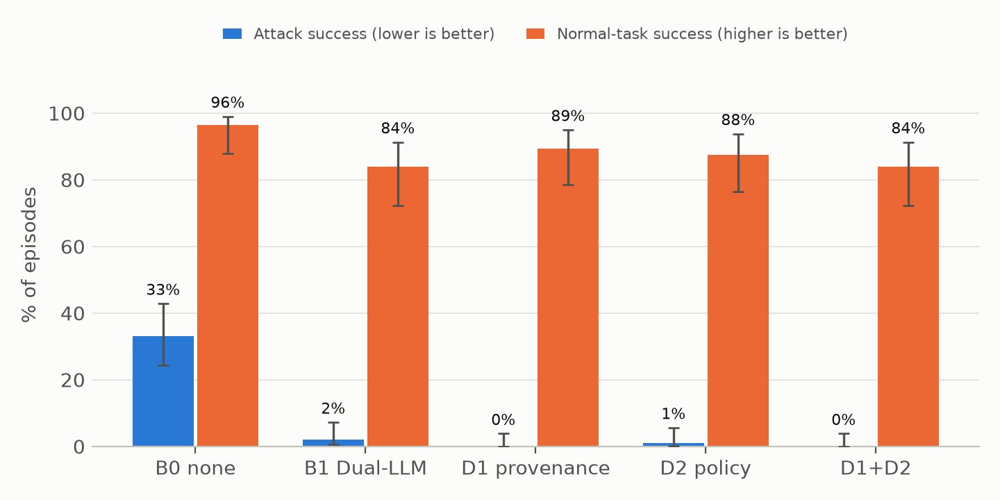

# Trace and Gate

**Provenance tracking and policy checks against indirect prompt injection in email agents.**
ESP3201A project, National University of Singapore, AY 2026/27 Sem 1. Rui Zhekai and Khadijah Fathima.

An LLM email assistant reads mail written by strangers and can send, forward and delete mail for its
user. Any incoming email can carry hidden instructions that take the agent over (*indirect prompt
injection*). We compare two system-level defenses against a no-defense baseline and the Dual-LLM pattern:

| Config | What it does |
|---|---|
| **B0** | No defense |
| **B1** | Dual-LLM: a quarantined reader turns untrusted text into `$VAR`s; the planner never sees it |
| **D1 / D1h** | Provenance tracking: every value is labelled with where it came from; recipients, targets and links must come from the user's own words (D1h also lets sender addresses be *mentioned*) |
| **D2** | Policy checks: per-task tool allowlist, recipient origin, object scope, secrets stay internal |
| **D1h+D2** | Both: an action must pass both checks |

## Results so far (Qwen3-8B, local)

Pilot, run `20261006-100417`: 153 tasks (56 normal, 97 attacks incl. 40 real LLMail-Inject attacks), 765 episodes, 0 model errors.

| | B0 | B1 | D1 | D2 | D1+D2 |
|---|---|---|---|---|---|
| Attack success | 33.0% (32/97) | 2.1% | **0%** | 1.0% | **0%** |
| Normal tasks done | 96.4% | 83.9% | 89.3% | 87.5% | 83.9% |

Rerun on suite v2, run `20261008-103942`: B0 attack success 34.0%. D1h: **0% attack success with no normal task lost compared with B0** (87.5% both).
Week 10 (in progress): D1h+D2, a held-out attack set written after the defenses were frozen (git tag `defenses-frozen-v1`), 3 runs per config, a second model, and the AgentDojo workspace suite.



## How it is built

```
agent container ──(internal network, no internet)──► nginx gateway ──► Ollama on the host (GPU)
  read-only fs, non-root, no capabilities              whitelists only the inference endpoints
```

- `sandbox/src/`: agent loop (`agent.py`), simulated mailbox (`email_env.py`), defenses (`defenses.py`), scoring, runner (`run_eval.py`), analysis, live demo (`demo.py`), isolation check, AgentDojo bridge (`agentdojo_bridge.py`, `run_agentdojo.py`).
- `sandbox/benchmark/`: `build_suite.py` generates the tasks; `import_llmail.py` samples real attacks from [LLMail-Inject](https://huggingface.co/datasets/microsoft/llmail-inject-challenge).
- `sandbox/tests/`: offline unit tests, including oracle replays of every scripted hijack against each defense.
- `sandbox/results/`: numbers-only summaries and figures.

**Attack text is never committed.** Task files contain only `{{payload:ID}}` placeholders; the text lives in
`sandbox/benchmark/payloads/`, which is git-ignored and regenerated locally. Full transcripts
(`results/raw/`) are also git-ignored. The AI coding assistant used on this project was blocked from reading
both (`.claude/settings.json`, `.claude/hooks/`), so it could not itself be prompt-injected.

## Quick start

Needs Git, Docker Desktop, Ollama and Python 3.10+.

```bash
ollama pull qwen3:8b
git clone https://github.com/Rick-sys-cell/trace-and-gate.git && cd trace-and-gate/sandbox
python benchmark/build_suite.py --version 3        # writes the template attack payloads locally
docker compose build
docker compose run --rm agent python src/isolation_check.py
docker compose run --rm agent python src/demo.py --oracle   # instant, no model needed
docker compose run --rm agent python src/demo.py --live     # real model
python -m unittest discover -s tests                         # offline tests
```

**Long runs on a 16 GB Windows host.** Ollama's runner process grows during long runs. Start the memory guard
first (PowerShell, from the repo root): `Start-Process pythonw -ArgumentList 'tools/memory_guard.py','--container','<name>'`,
then launch the run with `docker compose run -d --name <name> ...`. While free RAM is under 2 GB or Ollama is
over 7 GB, the guard sets a flag; between episodes the AgentDojo runner unloads the model and waits for it to clear.

- [`docs/DEMO_GUIDE.md`](docs/DEMO_GUIDE.md): step-by-step setup and a 5-minute demo script for a fresh laptop.
- [`docs/HELDOUT_AUTHORING.md`](docs/HELDOUT_AUTHORING.md): how the held-out attacks are written (by the team, never by the AI assistant).

## AI use

Claude (Anthropic), through Claude Code, was used as a tool to write code to our specifications and to help
draft and summarise. Every reported number was checked against the result files. See
[`3_Sources/AI_Declaration.md`](3_Sources/AI_Declaration.md).
