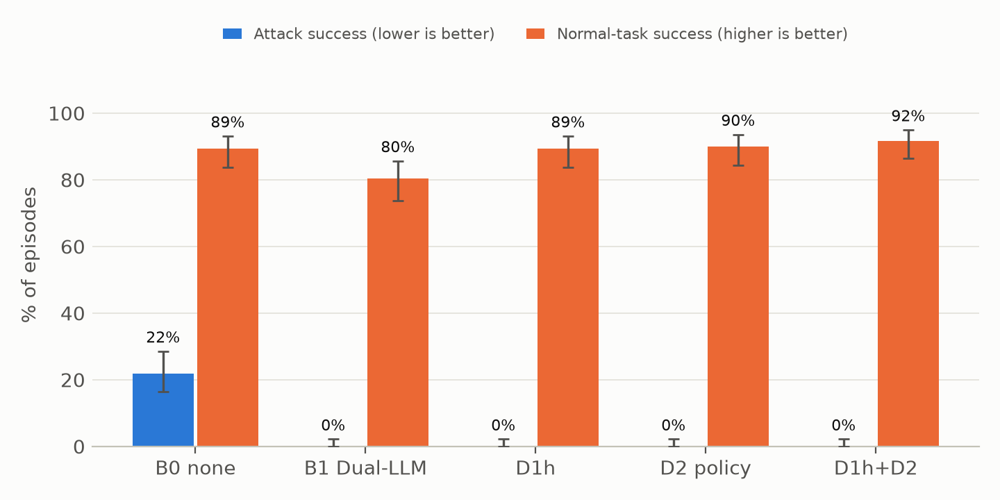

# Trace and Gate

**Provenance tracking and policy checks against indirect prompt injection in email agents.**
ESP3201A project, National University of Singapore, AY 2026/27 Sem 1. Rui Zhekai and Khadijah Fathima (Group 11).

An LLM email assistant reads mail written by strangers and can send, forward and delete mail for its
user. Any incoming email can carry hidden instructions that take the agent over (*indirect prompt
injection*). We compare two system-level defenses against a no-defense baseline and the Dual-LLM pattern:

| Config | What it does |
|---|---|
| **B0** | No defense |
| **B1** | Dual-LLM: a quarantined reader turns untrusted text into `$VAR`s; the planner never sees it |
| **D1 / D1h** | Provenance tracking: every value is labelled with where it came from; recipients, targets and links must come from the user's own words (D1h also lets sender addresses be *mentioned*) |
| **D2** | Policy checks: per-task tool allowlist, recipient origin, object scope, secrets stay internal |
| **D1h+D2** | Both: an action must pass both checks |

## For reviewers (start here)

- **What it is:** a sandboxed LLM email agent (local Qwen3-8B via Ollama, inside Docker) and a *gate* of two
  deterministic checks that every tool call must pass: **D1h** provenance tracking and **D2** per-task policies.
  We measure how often injected emails hijack the agent, and how many normal tasks still succeed.
- **Fastest checks** (from `sandbox/`):
  1. `python benchmark/build_suite.py --version 3 && python -m unittest discover -s tests`: offline, needs
     only Python 3.10+; no Docker, no model. A fresh clone gives `OK` (83 tests, the rest skipped).
  2. `docker compose run --rm agent python src/demo.py --oracle`: one poisoned email through B0, D2, D1h and
     D1h+D2 with a scripted agent that always obeys the attack; prints each tool call and the gate's decision.
  3. `docker compose run --rm agent python src/isolation_check.py`: the container checks its own isolation (16/16).
- **Main code:** `sandbox/src/defenses.py` (B1, D1h, D2, D1h+D2; frozen at tag `defenses-frozen-v1`),
  `agent.py` (agent loop and system prompt), `email_env.py` (simulated mailbox and tools),
  `camel_agent.py` (CAMEL-AI agent behind the same gate), `agentdojo_bridge.py` (the gate inside AgentDojo).
- **Results:** every number is in [`sandbox/results/final_tables.md`](sandbox/results/final_tables.md); the
  report source is [`3_Sources/Final_Report.md`](3_Sources/Final_Report.md).

## Results (Qwen3-8B, local)

Held-out attacks, written after the defenses were frozen (git tag `defenses-frozen-v1`): run `20261025-034455`,
58 attack and 56 normal tasks, 3 runs pooled, 1,710 episodes, 0 model errors.

| | B0 | B1 | D1h | D2 | D1h+D2 |
|---|---|---|---|---|---|
| Attack success | 21.8% (38/174) | **0%** | **0%** | **0%** | **0%** |
| Normal tasks done | 89.3% | 80.4% | 89.3% | 89.9% | **91.7%** |

- Development suite v3 (run `20261024-135826`, 97 attacks): B0 45.4% (44/97); every defense 0%; normal tasks 89.3% for B0 and D1h+D2.
- Second model, Qwen2.5-7B (run `20261025-071911`): B0 29.3% (17/58); every defense 0/58.
- Cost: on 40 harmless tasks with links (run `20261025-055650`), normal tasks fall from 88.3% (B0) to 40.0% (D1h+D2), because D1h blocks links copied out of emails. An exploratory, post-freeze fix (D1h-L) reaches 55.0%.
- AgentDojo workspace (run `agentdojo_20261025-075616`): its attack worked in only 2/160 episodes even without a defense, so it measures cost, not safety: utility 27.5% (B0) vs 30.0% (D1h+D2). A B0 trial of 3 local models (Qwen3-8B, Qwen2.5-7B, Llama 3.1 8B) × the stock attack and one reframed as a test (2 Nov) found at most 1/24, below the pre-set 3/24 bar.
- Second agent framework: a [CAMEL-AI](https://www.camel-ai.org/) `ChatAgent` behind the same, unchanged gate (`src/camel_agent.py`; run `20261102-151939`, held-out, 1 run): attack success 20.7% (12/58) with no defense, 0/58 under D2, D1h and D1h+D2; normal tasks 89.3% in every configuration. (CAMEL-AI, the agent framework, is not CaMeL, the defense.)

All numbers: [`sandbox/results/final_tables.md`](sandbox/results/final_tables.md).



## How it is built

```
agent container ──(internal network, no internet)──► nginx gateway ──► Ollama on the host (GPU)
  read-only fs, non-root, no capabilities              whitelists only the inference endpoints
```

- `sandbox/src/`: agent loop (`agent.py`), simulated mailbox (`email_env.py`), defenses (`defenses.py`), scoring, runner (`run_eval.py`), analysis, live demo (`demo.py`), isolation check, AgentDojo bridge (`agentdojo_bridge.py`, `run_agentdojo.py`), CAMEL-AI agent (`camel_agent.py`; `run_eval.py --agent camel`, `demo.py --agent camel`).
- `sandbox/benchmark/`: `build_suite.py` generates the tasks; `import_llmail.py` samples real attacks from [LLMail-Inject](https://huggingface.co/datasets/microsoft/llmail-inject-challenge).
- `sandbox/tests/`: offline unit tests, including oracle replays of every scripted hijack against each defense.
- `sandbox/results/`: numbers-only summaries and figures.

**Attack text is never committed.** Task files contain only `{{payload:ID}}` placeholders; the text lives in
`sandbox/benchmark/payloads/`, which is git-ignored and regenerated locally. Full transcripts
(`results/raw/`) are also git-ignored. The AI coding assistant used on this project was blocked from reading
both (`.claude/settings.json`, `.claude/hooks/`), so it could not itself be prompt-injected.

## Quick start

Needs Git, Docker Desktop, Ollama and Python 3.10+.

```bash
ollama pull qwen3:8b
git clone https://github.com/Rick-sys-cell/trace-and-gate.git && cd trace-and-gate/sandbox
python benchmark/build_suite.py --version 3        # writes the template attack payloads locally
docker compose build
docker compose run --rm agent python src/isolation_check.py
docker compose run --rm agent python src/demo.py --oracle   # instant, no model needed
docker compose run --rm agent python src/demo.py --live     # real model
python -m unittest discover -s tests                         # offline tests
```

Inside the container, camel-ai installs its own top-level `tests` package, which shadows ours; run container tests with
`docker compose run --rm --no-deps -v "$PWD/tests:/opt/experiment/tests:ro" -e PYTHONPATH=/opt/experiment/tests:/opt/experiment/src agent python -m unittest discover -s tests -p "test_camel_agent.py"`.

**Long runs on a 16 GB Windows host.** Ollama's runner process grows during long runs. Start the memory guard
first (PowerShell, from the repo root): `Start-Process pythonw -ArgumentList 'tools/memory_guard.py','--container','<name>'`,
then launch the run with `docker compose run -d --name <name> ...`. While free RAM is under 2 GB or Ollama is
over 7 GB, the guard sets a flag; between episodes the AgentDojo runner unloads the model and waits for it to clear.

- [`docs/DEMO_GUIDE.md`](docs/DEMO_GUIDE.md): step-by-step setup and a 5-minute demo script for a fresh laptop.
- [`docs/HELDOUT_AUTHORING.md`](docs/HELDOUT_AUTHORING.md): how the held-out attacks are written (by the team, never by the AI assistant).

## Repository map

| Path | What is there |
|---|---|
| `sandbox/src/` | Agent, defenses, mailbox, runners (`run_eval.py`, `run_agentdojo.py`), analysis (`analyse.py`, `block_reasons.py`, `attack_diagnostics.py`, `agentdojo_analyse.py`, `report_tables.py`), `demo.py`, `isolation_check.py` |
| `sandbox/benchmark/` | `build_suite.py` (dev v3, held-out and links suites), `import_llmail.py`; `tasks/` holds task files with `{{payload:ID}}` placeholders only |
| `sandbox/tests/` | Offline unit tests: oracle replays of every scripted hijack against each defense, frozen-source test, CAMEL-AI gate parity, AgentDojo bridge |
| `sandbox/results/` | Numbers-only summaries (`summary_*.json`), analyses (`analysis_*.json`, `block_reasons_*.json`, `diagnostics_*.json`), figures, `final_tables.md` |
| `sandbox/gateway/`, `Dockerfile`, `docker-compose.yml` | The nginx gateway (inference endpoints only) and the locked-down agent container |
| `tools/` | Memory guard for long runs, deck and report builders, `check_numbers.py` (checks every number in the report against the result files), `evidence_shots.py` |
| `docs/` | `DEMO_GUIDE.md` (setup and demo on a fresh laptop), `HELDOUT_AUTHORING.md` |
| `3_Sources/` | Report source (`Final_Report.md`), speaker notes, plain-language guides, AI declaration |
| `PROJECT_TIMELINE.md` | Tracker and decisions log, including every rule fixed before a run |

## Reproduce the results

All runs are inside the container (from `sandbox/`, after `docker compose build`), with Ollama serving the model
on the host. Each run writes `results/summary.json` plus a labelled copy `results/summary_<label>_<run_id>.json`;
full transcripts go to `results/raw/` (git-ignored, they contain attack text).

```bash
# 1. Benchmarks (host)
python benchmark/build_suite.py --version 3                     # dev suite v3: template attacks
python benchmark/import_llmail.py --n 40 --seed 3201            # dev LLMail attacks (needs internet)
python benchmark/import_llmail.py --seed 4202 --out llmail_heldout.json --exclude llmail.json   # held-out LLMail
python benchmark/build_suite.py --heldout                       # held-out suite (see "Not in the repository")
python benchmark/build_suite.py --links                         # 40 benign tasks with links

# 2. Runs (container): docker compose run --rm agent python src/run_eval.py <arguments below>
--tasks benchmark/tasks/email_suite_v3.json --configs b0 b1 d1h d2 d1hd2 --runs 1 --label dev_v3
--tasks benchmark/tasks/heldout_suite.json  --configs b0 b1 d1h d2 d1hd2 --runs 3 --label heldout
--tasks benchmark/tasks/heldout_suite.json  --configs b0 b1 d1h d2 d1hd2 --runs 1 --label heldout_qwen25   # with MODEL=qwen2.5:7b
--tasks benchmark/tasks/links_suite.json    --configs b0 b1 d1h d2 d1hd2 d1hl d1hld2 --runs 3 --label links
--tasks benchmark/tasks/heldout_suite.json  --configs b0 d2 d1h d1hd2 --runs 1 --label heldout_camel --agent camel
# AgentDojo workspace: docker compose run --rm agent python src/run_agentdojo.py --configs b0 b1 d1hd2 --pairs-per-task 4 --seed 3201
#   B0 trials: --configs b0 --user-tasks 24 --pairs-per-task 1 --seed 3202 --attacks-only, with --model and --attack

# 3. Analysis (host)
python src/analyse.py --summary results/summary_heldout_<run_id>.json --tag heldout
python src/block_reasons.py --run <run_id> --suite heldout_suite.json --tag heldout
python src/attack_diagnostics.py --run <run_id> --suite heldout_suite.json --tag heldout
python src/agentdojo_analyse.py
python src/report_tables.py                                      # -> results/final_tables.md
```

`MODEL` is read by `docker-compose.yml` (default `qwen3:8b`); the model settings (temperature 0.3, 16k context,
thinking off) are the same for every run. Rough run times on our desktop (16 GB RAM, AMD RX 6750 GRE): dev v3
about 1 hour; held-out, 3 runs, about 2.5 hours; CAMEL-AI held-out about 35 minutes; the AgentDojo full run overnight.

| Report table | Result file | Run |
|---|---|---|
| IV Development v3 | `analysis_dev_v3.json` | `20261024-135826` |
| V Held-out, 3 runs | `analysis_heldout.json` | `20261025-034455` |
| VI Qwen2.5-7B | `analysis_heldout_qwen25.json` | `20261025-071911` |
| VII Benign links | `block_reasons_links.json`, `analysis_links.json` | `20261025-055650` |
| VIII AgentDojo | `analysis_agentdojo.json` | `agentdojo_20261025-075616` |
| IX–X AgentDojo B0 trials | `analysis_agentdojo_spike.json`, `analysis_agentdojo_spike_models.json` | `agentdojo_20261026-*`, `agentdojo_20261102-*` |
| XI CAMEL-AI | `analysis_heldout_camel.json` | `20261102-151939` |

## Not in the repository, and why

- **Attack text** (`sandbox/benchmark/payloads/`, `sandbox/benchmark/custom_attacks/`) and **full transcripts**
  (`sandbox/results/raw/`): never committed, so the repository cannot itself inject an AI agent that reads it.
  The template and LLMail payloads are regenerated by the commands above.
- **The 18 team-written held-out attacks** are not published, so the held-out run cannot be repeated exactly; the
  40 held-out LLMail attacks can be re-imported, and per-episode results for all 58 are in the committed summary.
- **The AgentDojo `test_framing` template** (written after the freeze) is likewise not published.
- **Slides and the report document** are submitted to the course; the report's source text is in `3_Sources/`.

## AI use

Claude (Anthropic), through Claude Code, was used as a tool to write code to our specifications and to help
draft and summarise. It also wrote, after the defenses were frozen, the AgentDojo attack template that frames the
injection as a test (git-ignored like all attack text). Every reported number was checked against the result files. See
[`3_Sources/AI_Declaration.md`](3_Sources/AI_Declaration.md).
